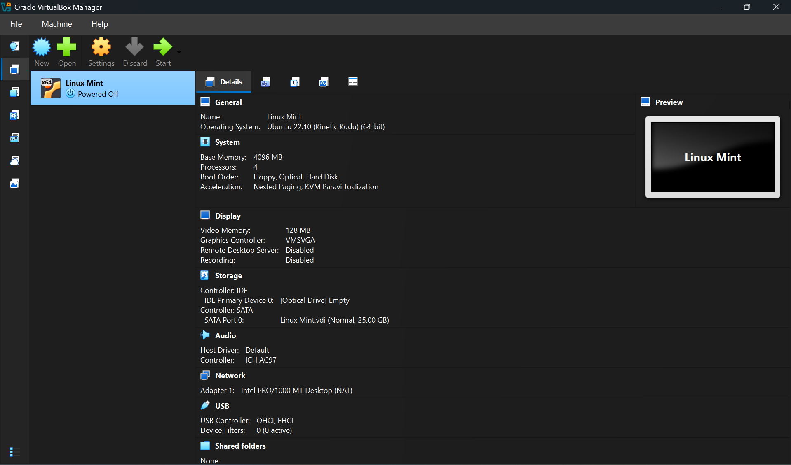
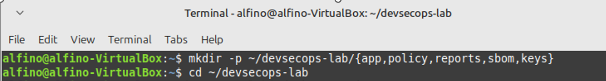
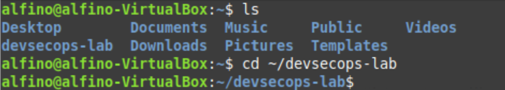
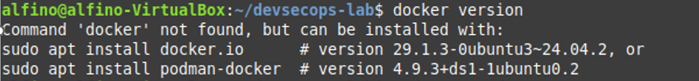
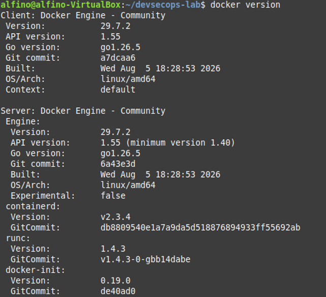
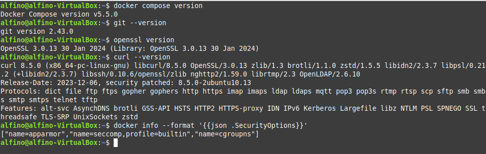

**LAPORAN WORKSHOP 1**

**Workshop DevOps**

Fondasi Teoretis dan Kerangka Kerja DevSecOps

> Nama : Alfino Dwi Rahmatullah – 3126640027
>
> Kelas : RPL LJ Teknik Informatika B
>
> Dosen : Dr. Ferry Astika Saputra, ST, M.Sc.

Politeknik Elektronika Negeri Surabaya

Departemen Teknik Informatika dan Komputer

Program Studi Teknik Informatika

2026

1.  **Arsitektur Laboratorium dan Prasyarat Lingkungan**

    ------------------------------------------------------------------------

    Laboratorium menggunakan satu host Linux atau mesin virtual yang menjalankan Docker Engine dan Docker Compose. Lingkungan diperlakukan sebagai baseline terisolasi: versi sistem, resource, network, izin pengguna, dan status daemon dicatat sebelum eksperimen agar hasil dapat direproduksi.

    ------------------------------------------------------------------------

    ------------------------------------------------------------------------

    Disini saya menggunakan Linux Mint sebagai Host/Virtual Machine dengan menggunakan Virtual Box

    ------------------------------------------------------------------------

    

    ------------------------------------------------------------------------

    ------------------------------------------------------------------------

    **Praktikum 1 - Menetapkan Baseline Laboratorium**

    ------------------------------------------------------------------------

    **Command 1**

    ------------------------------------------------------------------------

<table style="width:94%;">
<colgroup>
<col style="width: 94%" />
</colgroup>
<thead>
<tr>
<th>
mkdir -p ~/devsecops-lab/{app,policy,reports,sbom,keys}

cd ~/devsecops-lab
</th>
</tr>
</thead>
<tbody>
</tbody>
</table>

Capture

------------------------------------------------------------------------

------------------------------------------------------------------------

------------------------------------------------------------------------

------------------------------------------------------------------------

Analisa : Disini kita membuat direktori terlebih dahulu dengan menambahkan beberapa folder didalamnya

------------------------------------------------------------------------

------------------------------------------------------------------------

**Command 2**

------------------------------------------------------------------------

| docker version |
|----------------|

Capture a

------------------------------------------------------------------------

\
Capture b

------------------------------------------------------------------------

------------------------------------------------------------------------

------------------------------------------------------------------------

Analisa : Disini pastikan kalian menginstal juga Docker didalam Linux kita, dikarenakan jika langsung menggunakan command :\$ docker, maka akan muncul not found karena memang belum terinstall

------------------------------------------------------------------------

**Command 3**

------------------------------------------------------------------------

<table style="width:94%;">
<colgroup>
<col style="width: 94%" />
</colgroup>
<thead>
<tr>
<th>
docker compose version

git --version

openssl version

curl --version

docker info --format '{{json .SecurityOptions}}'
</th>
</tr>
</thead>
<tbody>
</tbody>
</table>

Capture a

------------------------------------------------------------------------

------------------------------------------------------------------------

------------------------------------------------------------------------

Analisa : Disini pastikan semua command berjalan dengan lancer dengan menampilkan versi dari docker, git dan curl, yang menandakan instalasi kita berjalan lancer

------------------------------------------------------------------------

------------------------------------------------------------------------

2.  **Verifikasi dan Skenario Pengujian**

    ------------------------------------------------------------------------

- **Docker daemon dapat diakses oleh akun praktikum dan docker compose menggunakan plugin v2.**

  ------------------------------------------------------------------------

  Akun pengguna berhasil mengakses Docker daemon tanpa memunculkan galat permission denied, dan Docker Compose terverifikasi menggunakan Plugin v2 (Docker Compose version v5.5.0)

  ------------------------------------------------------------------------

- **Direktori reports, sbom, dan keys tidak dipublikasikan sebagai web root.**

  ------------------------------------------------------------------------

  Struktur direktori dibuat pada path lokal /home/alfino/devsecops-lab/ , direktori reports/, sbom/, dan keys/ terisolasi pada lingkup pengguna lokal dan tidak dipublikasikan ke dalam web root atau port publik mana pun.

  ------------------------------------------------------------------------

- **SecurityOptions menampilkan mekanisme host yang tersedia; hasil berbeda antar distribusi harus dicatat.\**
  Output dari command (docker info --format '{{json .SecurityOptions}}')\
  **\["name=apparmor","name=seccomp,profile=builtin","name=cgroupns"\]**

  ------------------------------------------------------------------------

- **Pembaca menulis satu paragraf threat statement: aset, aktor ancaman, jalur serangan, dan dampak.\**
  Aset awal yang dilindungi adalah kredensial yang ada di direktori keys, sbom, dan direktori reports. Untuk ancaman dari eksternal yang tidak memiliki hak akses tinggi, atau mungkin jalurnya di direktori jaringan di public, dengan inject kode yang mungkin berbahaya, dampaknya direktori bisa terkunci/rusak atau mungkin data kita dimasukin virus.

  ------------------------------------------------------------------------

  ------------------------------------------------------------------------

3.  **Verifikasi dan Skenario Pengujian**

    ------------------------------------------------------------------------

- **Mengapa DevSecOps tidak dapat direduksi menjadi penambahan scanner pada pipeline?**

  ------------------------------------------------------------------------

  DevSecOps tidak dapat direduksi menjadi sekadar menambahkan scanner karena DevSecOps adalah perubahan budaya, proses, dan kolaborasi, bukan sekadar otomatisasi alat. Menambahkan pemindai otomatis (scanner) seperti SAST, DAST, atau dependency check ke dalam pipeline CI/CD hanyalah komponen teknis kecil dari strategi keamanan yang jauh lebih besar.

  ------------------------------------------------------------------------

- **Evidence apa yang membedakan klaim kontrol dari kontrol yang benar-benar terverifikasi?**

  ------------------------------------------------------------------------

  Bukti terverifikasi berupa artefak terstruktur (SARIF, SBOM CycloneDX/SPDX, tanda tangan digital, SLSA provenance) yang dapat ditelusuri ke commit, image digest, rule set, dan log build spesifik.

  ------------------------------------------------------------------------

  ------------------------------------------------------------------------

- **Bagaimana shared responsibility memengaruhi ownership risiko dan tindak lanjut temuan?**

  ------------------------------------------------------------------------

  Membagi akuntabilitas risiko ke pihak teknis (Developer memperbaiki kode, Security merancang rule, Operator mengelola runtime, Product Owner menentukan toleransi risiko) melalui jalur eskalasi dan waiver yang formal dan berbatas waktu

  ------------------------------------------------------------------------
