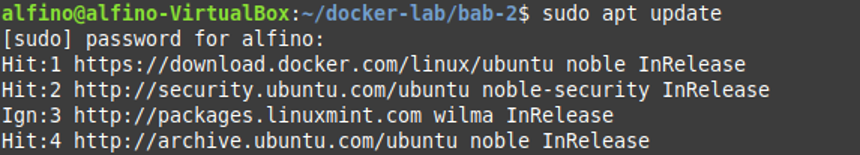
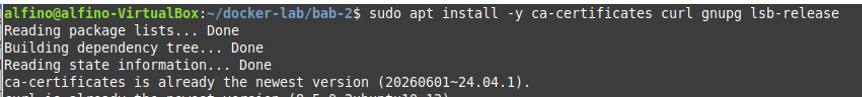
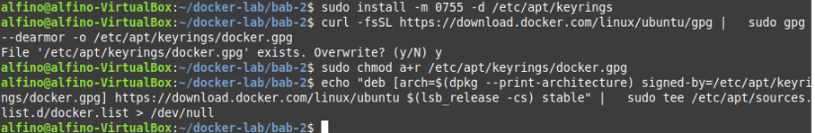
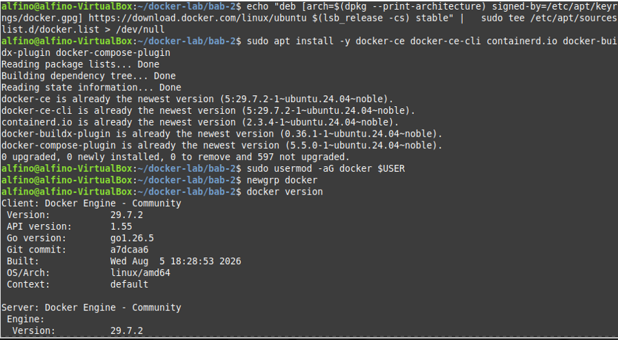
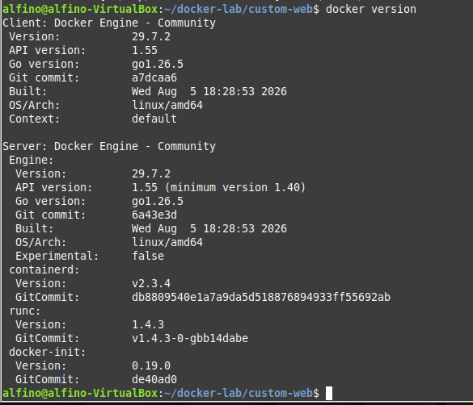
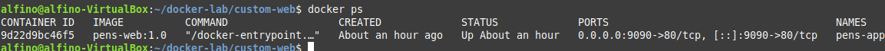
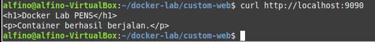
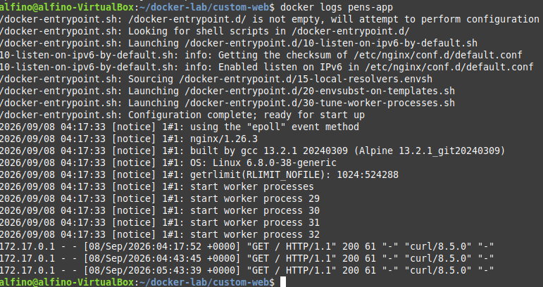

**LAPORAN WORKSHOP 2**

**Workshop DevOps**

Fondasi Teoretis dan Kerangka Kerja DevSecOps

> Nama : Alfino Dwi Rahmatullah – 3126640027
>
> Kelas : RPL LJ Teknik Informatika B
>
> Dosen : Dr. Ferry Astika Saputra, ST, M.Sc.

Politeknik Elektronika Negeri Surabaya

Departemen Teknik Informatika dan Komputer

Program Studi Teknik Informatika

2026

1.  Pendahuluan

    Praktikum ini fokusnya pada pemahaman fundamental teknologi containerization dan implementasi Docker Engine. Berbeda dengan virtual machine yang mengemulasikan perangkat keras penuh serta menjalankan guest kernel tersendiri, kontainer merupakan isolasi proses pada tingkat sistem operasi yang berbagi kernel dengan host. Isolasi tersebut diwujudkan melalui fitur kernel Linux berupa namespaces untuk membatasi ruang pandang sumber daya (seperti proses, jaringan, dan mount point) serta control groups (cgroups) untuk mengatur kuota konsumsi CPU maupun memori. Karakteristik ini membuat kontainer jauh lebih ringan, memiliki ukuran berkas yang efisien, dan waktu mulai (startup) yang cepat jika dibandingkan dengan mesin virtual.

    Konsep Container dan Instalasi Docker, dengan menggunakan Ubuntu LinuxMint di VirtualBox, Docker Engine v29.x, Docker Compose v5.x. Dengan tujuan laporan untuk menguji isolasi proses container, menjalankan web server statis, dan menganalisis arsitektur layer

2.  Bukti Screenshoot & Output

- Instalasi Docker Engine Ubuntu

  

  

  

  

- Docker Engine aktif dan docker version menampilkan Client serta Server

  

- Screenshot docker compose ps atau docker ps yang menunjukkan service berjalan.

  

- Screenshot hasil curl/browser/API/dashboard sesuai target bab.

  

- Cuplikan log atau query yang membuktikan sistem bekerja.

  

3.  Analisis

<!-- -->

1.  Diagnosis Masalah

    Pada awal konfigurasi repositori APT, terjadi kendala kegagalan unduhan paket akibat ketidakcocokan kode rilis distribusi Linux Mint pada URL repositori resmi Docker. Masalah didiagnosis melalui pesan galat 404 Not Found pada log APT. Tindakan korektif dilakukan dengan menyelaraskan variabel penamaan repositori ke basis Ubuntu noble (\$UBUNTU_CODENAME) serta memperbarui keyring GPG resmi Docker sebelum melakukan instalasi ulang paket docker-ce.

2.  Rekomendasi untuk ProductionRisiko Keamanan

    Keanggotaan akun pada grup docker menghilangkan batasan least privilege karena pengguna dapat menjalankan container dengan akses berkas host secara bebas, dan penggunaan opsi -p 9090:80 tanpa deklarasi IP lokal mengikat port ke antarmuka 0.0.0.0, yang membuat web server dapat diakses dari jaringan luar VM tanpa pengamanan autentikasi.

3.  Rekomendasi untuk production-like environment.

    Bisa dengan menambahkan direktif USER \<non-root-uid\> pada Dockerfile agar proses Nginx tidak berjalan dengan privilese tertinggi, mengikat port hanya ke localhost internal (misalnya -p 127.0.0.1:9090:80) dan menempatkan reverse proxy / WAF di depan aplikasi. Mengganti tag nginx:1.26-alpine dengan hash digest kriptografis OCI (nginx@sha256:...) untuk memastikan dependensi mudah dilacak.

<!-- -->

4.  Soal dan Jawaban Evaluasi

<!-- -->

1.  Mengapa penggunaan tag latest tidak dianjurkan untuk deployment yang harus reproducible?

    Tag Docker bersifat mutable (dapat dipindahkan kapan saja oleh pembuat image untuk menunjuk ke versi rilis yang baru). Jika menggunakan latest, proses build atau deployment ulang di masa depan dapat mengunduh artefak dengan dependensi yang berbeda meski kode aplikasi tidak berubah

2.  Jelaskan peran containerd dan runc dalam arsitektur Docker.

- Containerd

  Bertindak sebagai high-level container runtime yang mengelola siklus hidup container secara menyeluruh, termasuk manajemen image, penyimpanan snapshot layer, penyiapan jaringan, dan pengawasan eksekusi.

- Runc

  Merupakan low-level runtime berbasis standar OCI (Open Container Initiative) yang berinteraksi langsung dengan kernel Linux untuk menciptakan isolasi proses menggunakan namespaces, cgroups, dan capabilities.

3.  Apa konsekuensi keamanan dari memasukkan user ke group docker?

    Memasukkan pengguna ke dalam grup docker secara praktis setara dengan memberikan akses root penuh tanpa password pada host. Pengguna non-root yang tergabung dalam grup ini dapat mengeksekusi container dengan flag --privileged atau melakukan bind mount direktori root host (-v /:/host), sehingga pengguna dapat membaca, mengubah, atau mengambil alih seluruh file sistem host di luar batasan hak akses normalnya.

4.  Bandingkan layer image nginx:1.26-alpine dan image custom yang Anda buat.

    **Nginx:1.26-alpine** : Base image read-only yang tersusun atas layer OS minimal Alpine Linux, dependensi pustaka C (musl), konfigurasi default server, dan binari Nginx

    **pens-web:1.0 :** Menggunakan kembali /reuse seluruh layer dari nginx:1.26-alpine, kemudian menambahkan layer *read-only* baru di atasnya yang dihasilkan dari instruksi COPY index.html dan metadata dari LABEL. Pendekatan layer ini menghemat penyimpanan karena layer dasar tidak digandakan ulang.

5.  Kapan sebaiknya memilih VM daripada container?

- Ketika sistem membutuhkan isolasi keamanan tingkat perangkat keras yang sangat ketat, misalnya pada lingkungan multi-tenant publik yang tidak saling percaya.

- Ketika aplikasi memerlukan kernel atau sistem operasi yang berbeda dari host, seperti menjalankan Windows di atas host Linux atau membutuhkan modul kernel khusus.

- Ketika menjalankan aplikasi monolitik warisan yang membutuhkan kontrol penuh terhadap perangkat keras atau prosedur booting tingkat rendah.
