**LAPORAN WORKSHOP 3**

**Workshop DevOps**

Docker Network, Volume, Bind Mount, tmpfs, dan Compose

> Nama : Alfino Dwi Rahmatullah – 3126640027
>
> Kelas : RPL LJ Teknik Informatika B
>
> Dosen : Dr. Ferry Astika Saputra, ST, M.Sc.

Politeknik Elektronika Negeri Surabaya

Departemen Teknik Informatika dan Komputer

Program Studi Teknik Informatika

2026

1.  Pendahuluan

    Penugasan praktikum ini berfokus pada integrasi dua modul acuan, yaitu Bab 3 sebagai landasan teoretis dan Bab 3 Cheatsheet (CS) sebagai acuan eksekusi teknis. Modul Bab 3 dijadikan rujukan pemahaman konsep jaringan user-defined bridge, pemetaan lifecycle penyimpanan (volume, bind mount, dan tmpfs), segmentasi keamanan least exposure, serta pemenuhan target verifikasi skenario pengujian. Sementara itu, seluruh tahapan teknis langkah demi langkah—mulai dari pembuatan struktur direktori, penulisan berkas compose.yaml, penyusunan kode backend Flask, pembuatan Dockerfile non-root, konfigurasi reverse proxy Nginx, hingga orkestrasi siklus hidup kontainer—dikerjakan secara penuh mengikuti instruksi cheatsheet (bab-03-cs.md) karena telah melengkapi seluruh kebutuhan dependensi aplikasi yang siap jalan serta mengimplementasikan standar keamanan kontainer yang presisi.

2.  Langkah Praktikum Eksploratif

**1. Pembuatan Struktur Direktori (mkdir -p ...)**

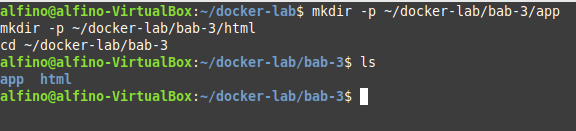

> Memisahkan direktori kerja app/ (untuk kode sumber backend) dan html/. Dalam Docker, direktori pemanggilan *build* disebut **build context**. Memisahkan direktori mencegah berkas sensitif dari folder lain ikut terkirim ke dalam proses pembuatan image (*image build*).

**2. Menulis compose.yaml**

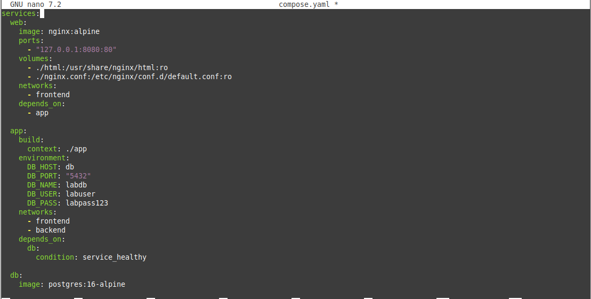

> Konfigurasi ini menerapkan prinsip *least exposure* dengan mengikat port Nginx khusus ke alamat loopback (127.0.0.1:8080:80) dan menempatkan database di internal backend. Pemasangan konfigurasi secara *read-only* (:ro) mencegah manipulasi berkas host dari dalam container, sedangkan klausul condition: service_healthy memastikan kontainer Flask baru berjalan setelah PostgreSQL siap melayani koneksi.

**3. Membuat aplikasi Flask**

Buat app/requirements.txt:

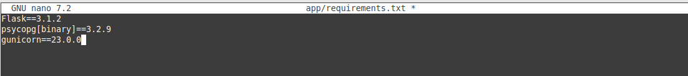

Buat app/app.py

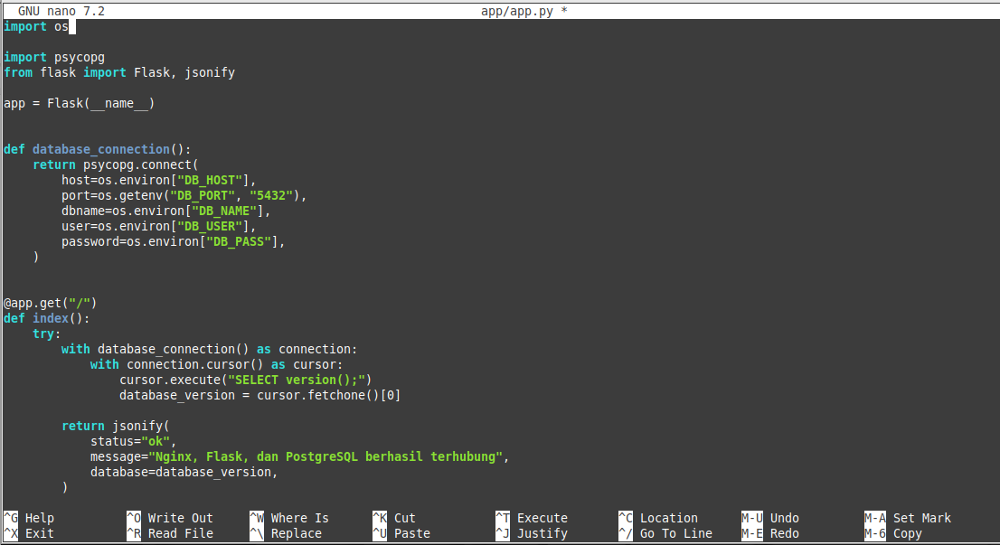

> Aplikasi backend dibangun secara modular dengan memisahkan parameter koneksi database ke dalam variabel lingkungan (environment variables). Penyediaan rute /health yang mengeksekusi kueri SELECT 1; bertindak sebagai pengujian kesiapan (readiness check) riil untuk memvalidasi bahwa koneksi database benar-benar aktif, bukan sekadar proses aplikasi yang menyala.

**4. Membuat Dockerfile aplikasi**

Buat app/Dockerfile:

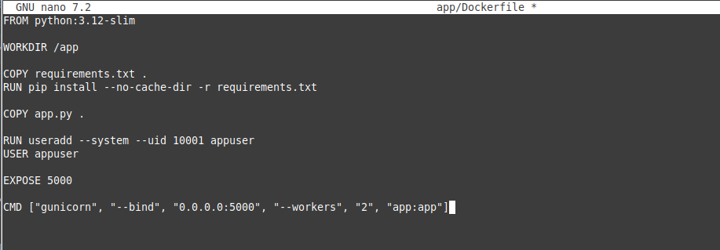

> Dockerfile ini menerapkan *hardening* container dengan menggunakan base image minimal python:3.12-slim guna memperkecil ukuran artefak dan memangkas kerentanan bawaan. Penerapan instruksi USER appuser (UID 10001) memastikan proses Gunicorn berjalan tanpa privilese root, membatasi dampak eksploitasi sistem jika terjadi celah injeksi pada kode aplikasi.

**5. Membuat konfigurasi Nginx**

Buat nginx.conf:

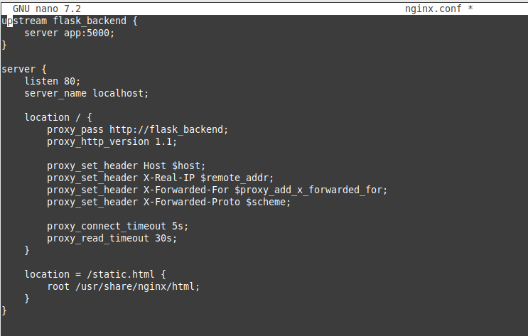

Nginx bertindak sebagai *reverse proxy* yang mengarahkan trafik eksternal menuju service internal app:5000 menggunakan resolusi DNS bawaan Docker. Penyisipan header proksi seperti X-Real-IP dan X-Forwarded-For mempertahankan informasi alamat IP asli klien untuk kebutuhan pencatatan log (*logging*) dan penelusuran audit keamanan (*audit trail*) di sisi backend.

**6. Membuat halaman statis opsional**

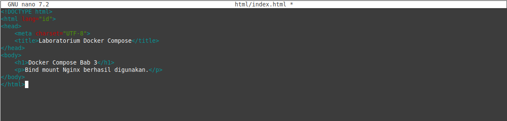

Penyediaan berkas html/index.html menguji efektivitas bind mount pada Nginx, yang memungkinkan perubahan konten di host langsung tercermin pada rute /static.html tanpa memerlukan rebuild image. Pengujian ini membuktikan pemisahan antara penyajian aset statis berbasis filesystem dengan pemrosesan API dinamis melalui proksi.

**7. Memvalidasi Compose**

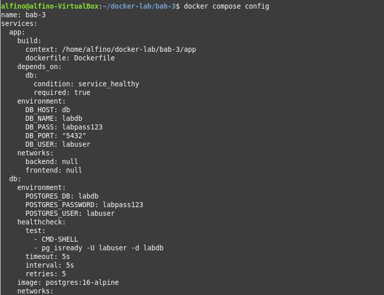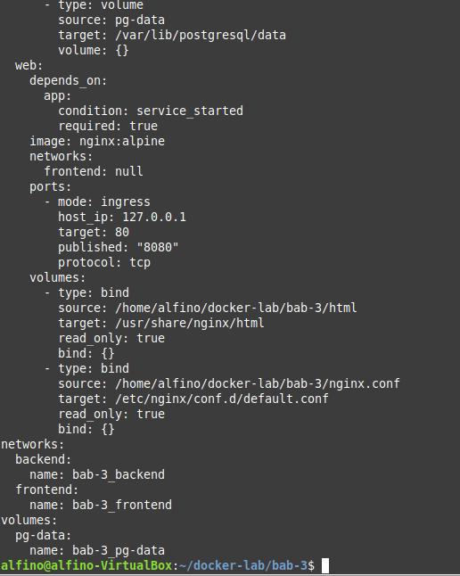

Tidak ada error saat menjalankan docker compose config, dan service yang muncul sesuai dengan panduan

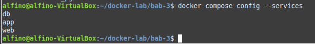

Penyediaan berkas html/index.html menguji efektivitas bind mount pada Nginx, yang memungkinkan perubahan konten di host langsung tercermin pada rute /static.html tanpa memerlukan rebuild image. Pengujian ini membuktikan pemisahan antara penyajian aset statis berbasis filesystem dengan pemrosesan API dinamis melalui proksi.

**8. Menjalankan stack**

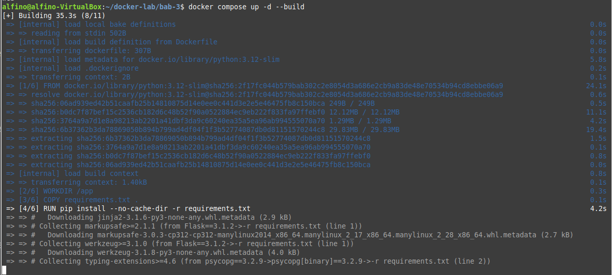

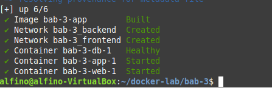

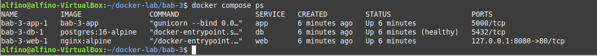

> Keluaran konseptualnya sudah sesuai dengan panduan, Eksekusi docker compose up -d --build mengotomatisasi proses kompilasi image backend dan orkestrasi seluruh dependensi di latar belakang. Status Up (healthy) pada service database mengonfirmasi bahwa uji kesehatan berkala pg_isready berhasil dipenuhi sebelum aplikasi backend mulai melayani permintaan pengguna.

**9. Menguji aplikasi**

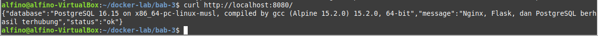

Uji health endpoint: dan Uji halaman statis:

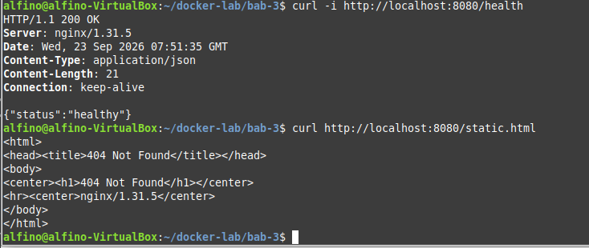

> Pengujian melalui perintah curl memvalidasi keberhasilan komunikasi end-to-end melintasi tiga zona: klien mengakses port publik Nginx, diteruskan ke Flask melalui jaringan frontend, dan kueri versi database dieksekusi via jaringan backend. Respons JSON status ok dan kode HTTP 200 membuktikan integrasi antar-layanan berjalan tanpa *bottleneck*.**\**

**10. Memeriksa log**

Log tail -100

Untuk melihat log 100 baris dari bawah

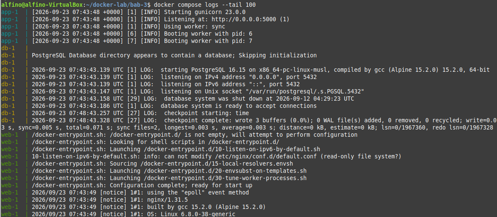

Log realtime

Untuk melihat log secara Realtime

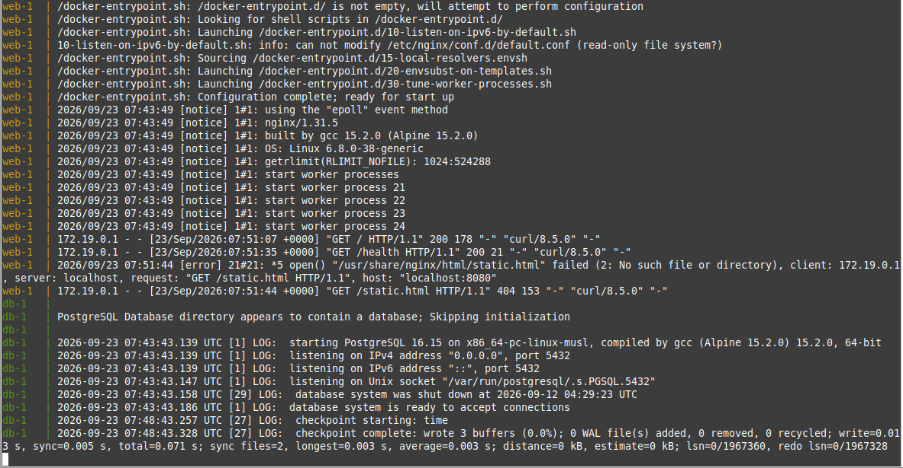

Log service tertentu:

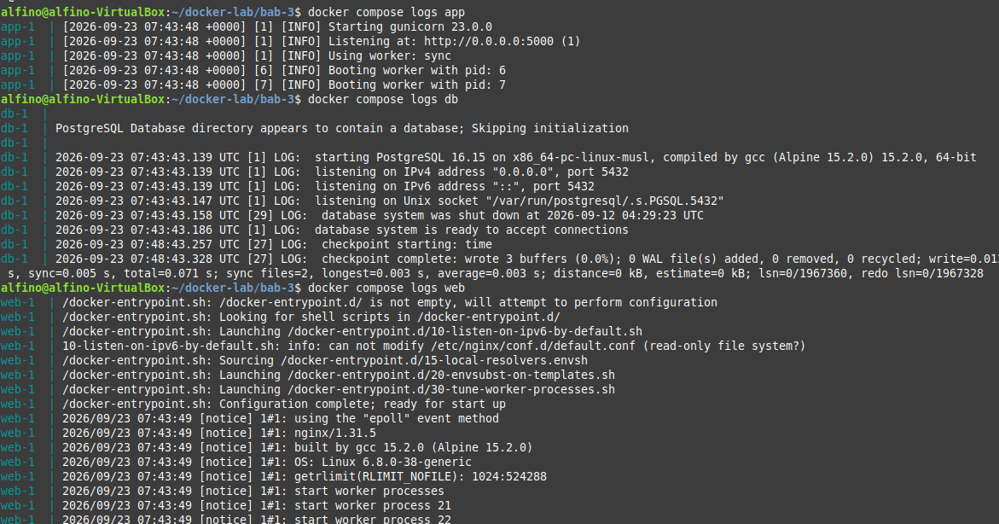

> Pemeriksaan log gabungan maupun spesifik per service merupakan implementasi *observability* untuk memantau lalu lintas data dan siklus aplikasi secara transparan. Data log ini menjadi bukti (*evidence*) operasional guna mendeteksi galat kueri, mengawasi respons status HTTP, serta mempercepat proses investigasi jika terjadi anomali sistem.

**11. Menghentikan lingkungan**

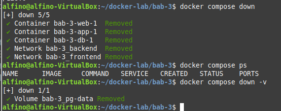

> Langkah ini mendemonstrasikan tata kelola siklus hidup lingkungan delivery secara aman. Penggunaan docker compose down menghentikan container dan membersihkan jaringan tanpa menghapus direktori persistensi pg-data, sedangkan penambahan flag -v mendemonstrasikan penghapusan destruktif pada volume data saat reset laboratorium diperlukan.

3.  Verifikasi dan Skenario Pengujian

<table style="width:99%;">
<colgroup>
<col style="width: 22%" />
<col style="width: 37%" />
<col style="width: 27%" />
<col style="width: 12%" />
</colgroup>
<thead>
<tr>
<th>Skenario Pengujian</th>
<th>Perintah</th>
<th>Output Keberhasilan</th>
<th>Status</th>
</tr>
</thead>
<tbody>
<tr>
<td>Container di user-defined bridge dapat saling resolve menggunakan nama</td>
<td>docker exec bab-3-web-1 ping -c 3 app</td>
<td>Berhasil menerima 3 paket ICMP balasan dari server-b tanpa <em>packet loss</em>.</td>
<td>Berhasil</td>
</tr>
<tr>
<td colspan="4" style="text-align: center;">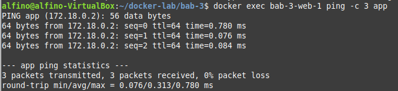</td>
</tr>
<tr>
<td>Data di named volume tetap ada setelah container dihapus.</td>
<td>docker compose rm -f -s db &amp;&amp; docker volume ls | grep pg-data &amp;&amp; docker compose up -d db</td>
<td>Berkas log.txt tetap terbaca utuh walaupun container writer telah dihapus.</td>
<td>Berhasil</td>
</tr>
<tr>
<td colspan="4">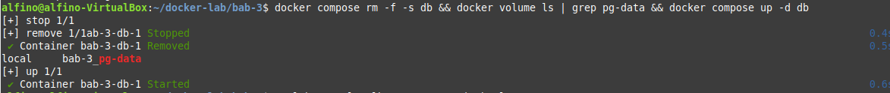</td>
</tr>
<tr>
<td>Bind mount menunjukkan perubahan file host tanpa rebuild image</td>
<td>curl http://localhost:8080/static.html</td>
<td>Perubahan berkas html/index.html langsung tampil seketika di peramban/curl[cite: 4, 20].</td>
<td>Berhasil</td>
</tr>
<tr>
<td colspan="4">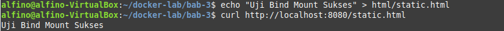</td>
</tr>
<tr>
<td>Compose stack web-app-db berjalan dan API health menampilkan koneksi database</td>
<td>docker compose ps &amp; curl -i http://localhost:8080/health</td>
<td>Seluruh kontainer berstatus <em>Up</em>, kontainer database berstatus <em>(healthy)</em>, dan respons API HTTP 200 OK</td>
<td>Berhasil</td>
</tr>
<tr>
<td colspan="4">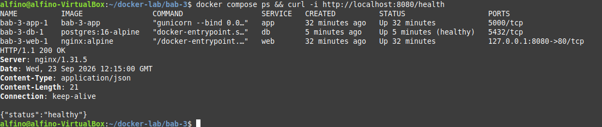</td>
</tr>
</tbody>
</table>

4.  Jawaban Evaluasi dan Latihan Mandiri

<!-- -->

1.  Mengapa user-defined bridge lebih baik daripada default bridge untuk multi-container app?

- User-defined bridge menyediakan resolusi DNS internal otomatis berbasis nama container (service name), sedangkan pada default bridge resolusi nama tidak tersedia secara otomatis (harus menggunakan opsi --link yang sudah usang). Memberikan isolasi jaringan yang lebih ketat: container yang berada di user-defined bridge berbeda tidak dapat saling mengakses secara langsung, mengurangi bidang serangan (attack surface). Memungkinkan konfigurasi subnet, gateway, dan aturan firewall yang dapat disesuaikan dengan kebutuhan arsitektur sistem.

2.  Apa risiko bind mount terhadap keamanan host?

    Bind mount secara langsung memetakan struktur file atau direktori host ke dalam container. Jika container dijalankan dengan izin tulis (write access) dan mengalami peretasan (container compromise), proses jahat di dalam container dapat memodifikasi, menghapus, atau merusak file sistem host. Melakukan bind mount pada direktori sensitif (seperti /, /etc, atau /var/run/docker.sock) dapat memberikan akses setara root host kepada pengguna container, sehingga membatalkan isolasi kernel.

3.  Apa perbedaan docker compose down dan docker compose down -v?

- Docker compose down\
  Menghentikan dan menghapus container, jaringan (networks), serta anonymous volumes yang dibuat oleh stack Compose, namun tetap mempertahankan named volumes beserta seluruh data di dalamnya.

- Docker compose down -v:

  Bersifat destruktif karena selain menghapus container dan jaringan, perintah ini menghapus seluruh named volumes (misalnya pg-data), sehingga data persisten bisnis atau database akan hilang secara permanen.

4.  Kapan depends_on dengan healthcheck lebih tepat daripada depends_on biasa?

- depends_on biasa hanya menjamin urutan pembuatan container berdasarkan status proses (container created/started). Kondisi ini belum menjamin bahwa aplikasi di dalamnya (seperti PostgreSQL) telah selesai melakukan inisialisasi socket dan siap menerima koneksi.

- Penggunaan depends_on dengan kondisi service_healthy memastikan bahwa service dependen (seperti aplikasi backend) baru akan dijalankan setelah target dependensi (database) benar-benar lolos pengujian fungsional (healthcheck query pg_isready), mencegah terjadinya startup crash akibat kegagalan koneksi awal.

5.  Bagaimana strategi backup volume untuk database produksi?

- Melakukan snapshot atau dump logis aplikasi secara terjadwal (misalnya menggunakan utilitas native seperti pg_dump untuk PostgreSQL) guna memastikan konsistensi data transaksi.

- Memanfaatkan container sementara (ephemeral) yang memasang volume target dalam mode hanya-baca (:ro) untuk mengarsipkan data ke storage eksternal atau object storage (seperti Amazon S3).

- Menerapkan kebijakan retensi backup, enkripsi arsip, serta melakukan latihan pemulihan data (restore testing) secara berkala untuk memvalidasi bahwa integritas file cadangan dapat dipulihkan saat terjadi insiden.
