**LAPORAN WORKSHOP 4**

**Workshop DevOps**

Apache httpd, Nginx, virtual host, reverse proxy, TLS.

> Nama : Alfino Dwi Rahmatullah – 3126640027
>
> Kelas : RPL LJ Teknik Informatika B
>
> Dosen : Dr. Ferry Astika Saputra, ST, M.Sc.

Politeknik Elektronika Negeri Surabaya

Departemen Teknik Informatika dan Komputer

Program Studi Teknik Informatika

2026

1.  Pendahuluan

    Penugasan praktikum ini berfokus pada dua modul, yaitu Bab 4 sebagai landasan teori dan Bab 4 Cheatsheet (CS) sebagai acuan eksekusi praktikum. Modul Bab 4 dijadikan rujukan pemahaman konsep web service sebagai aplikasi, arsitektur peran antara reverse proxy (Nginx) dan origin server (Apache), mekanisme TLS beserta siklus sertifikat, transmisi trusted headers, serta tata kelola logging dan audit keamanan sistem. Sementara itu, seluruh tahapan teknis langkah demi langkah mulai dari penyusunan struktur direktori terisolasi, penerbitan sertifikat digital TLS self-signed dengan ekstensi SAN menggunakan OpenSSL, penulisan orkestrasi compose.yaml, konfigurasi routing proxy beserta redirect HTTP ke HTTPS dan security headers, pembuatan origin server statis Apache, perakitan aplikasi backend Flask dengan Dockerfile non-root, hingga pengujian isolasi jaringan privat web-net dikerjakan secara penuh mengikuti instruksi cheatsheet (bab-04-cs.md).

2.  Peta Konsep Apache httpd, Nginx, virtual host, reverse proxy, TLS.

    Peta konsep disusun oleh kelompok 2, dengan anggota :

    Alfino Dwi Rahmatullah : 3126640027

    Adrian Sondang Irawan : 3126640029

    Muchamad Syikha Akmal : 3126640035

    Peta Konsep

    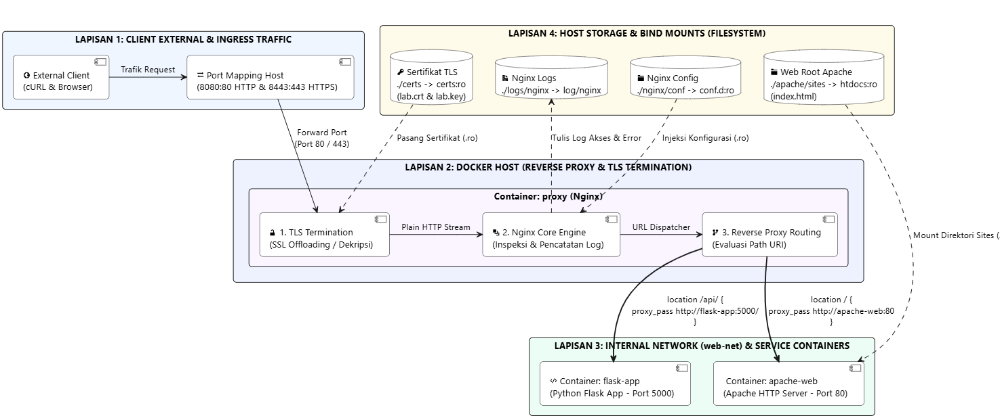

    Penjelasan singkat

<!-- -->

1.  **Lapisan 1: Client External & Ingress Traffic**

    Berfungsi sebagai one gate dari jaringan luar. Port publikasi host dibatasi pada antarmuka *loopback* (127.0.0.1:8080 untuk HTTP dan 127.0.0.1:8443 untuk HTTPS). Hal ini mencegah eksposur port yang tidak perlu ke jaringan publik sekaligus menyiapkan mekanisme *HTTP-to-HTTPS redirection*.

2.  **Lapisan 2: Docker Host (Reverse Proxy & TLS Termination)**

    Kontainer proxy (Nginx) bertindak sebagai *security boundary* dan pengendali lalu linta. Di lapisan ini terjadi proses dekripsi (*TLS Termination / SSL Offloading*) sehingga beban komputasi dipusatkan di depan, sebelum aliran data *plain* HTTP didistribusikan ke backend berdasarkan evaluasi URI (*path routing*: / ke Apache dan /api/ ke Flask).

3.  **Lapisan 3: Internal Network (web-net) & Service Containers**

    Menerapkan isolasi perimeter jaringan backend. Kontainer apache-web (port 80) dan flask-app (port 5000) tidak memiliki *published port* ke host dan murni beroperasi di dalam jaringan privat web-net. Komunikasi antar-kontainer mengandalkan fitur *service discovery* dan DNS internal Docker tanpa mengekspos IP fisik atau membuka celah serangan langsung ke aplikasi backend.

4.  **Lapisan 4: Host Storage & Bind Mounts (Filesystem)**

    Menyeimbangkan aspek ketahanan data, pemantauan, dan pengerasan keamanan . Pemasangan atribut *read-only* (:ro) pada berkas konfigurasi Nginx, sertifikat TLS (lab.crt, lab.key), dan web root Apache melindungi integritas sistem dari modifikasi ilegal dari dalam kontainer. Sementara itu, pemasangan volume log secara dua arah memastikan data audit (access.log dan error.log) tetap tersimpan permanen di host untuk kebutuhan analisis.

<!-- -->

3.  Langkah Praktikum Eksploratif

    Struktur File :

    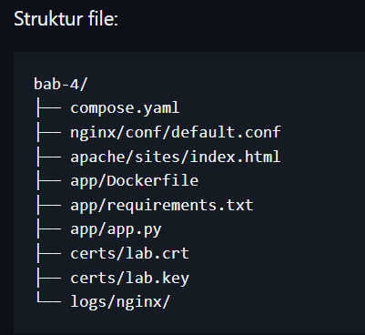

**1. Direktori Kerja**

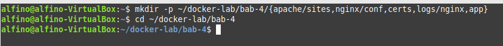

> Pembuatan subdirektori memisahkan berkas konfigurasi proxy, sertifikat, kode aplikasi backend, dan log akses ke dalam ruang lingkup yang terisolasi. Struktur ini membatasi build context kontainer agar proses perakitan image aplikasi tidak mengekspos berkas sensitif dari direktori lain.

**2. Sertifikat TLS Laboratorium**

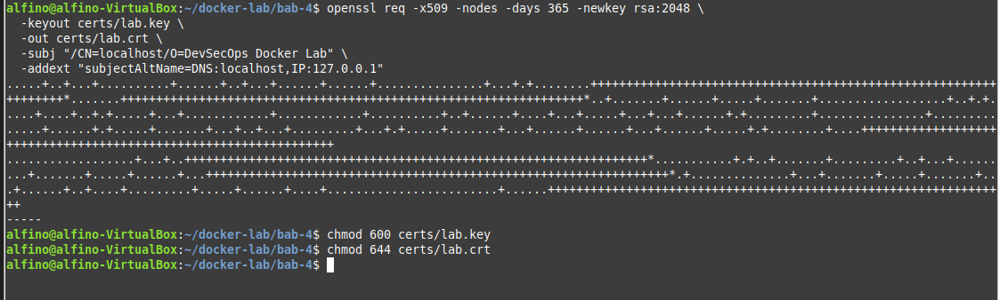

> Pembuatan sertifikat self-signed X.509 mengimplementasikan ekstensi modern SAN (Subject Alternative Name) agar koneksi lokal via domain localhost maupun IP 127.0.0.1 valid pada standar TLS kontemporer. hak akses chmod 600 pada private key menggunakan prinsip hak akses guna mencegah kebocoran key kepada pengguna lain di level host.

**3. File compose.yaml**

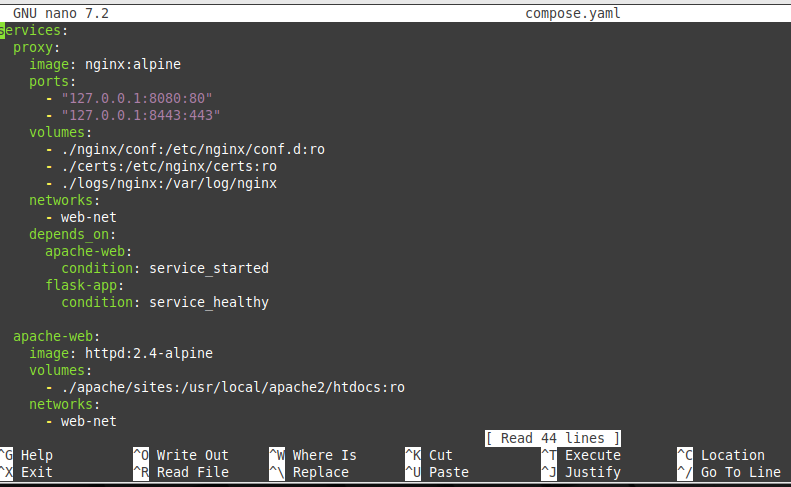

> File ini menerapkan prinsip least exposure dengan hanya memublikasikan port milik Nginx ke antarmuka loopback host (127.0.0.1), sementara service apache-web dan flask-app diisolasi tanpa publikasi port di jaringan web-net.

**4. File nginx/conf/default.conf**

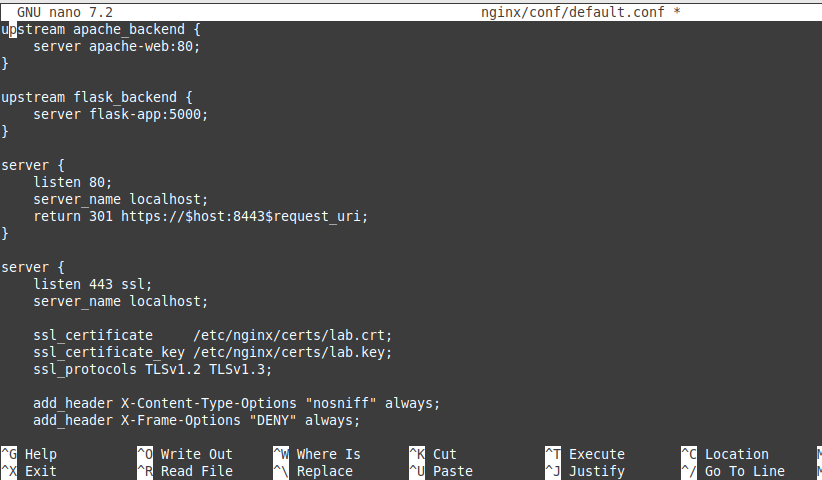

> Konfigurasi Nginx memisahkan fungsi publik dengan pengalihan otomatis HTTP ke HTTPS (HTTP 301 Redirect) dan membatasi protokol ke TLSv1.2/TLSv1.3. Penambahan security headers mitigatif (nosniff, DENY) dan transmisi header identitas (X-Forwarded-Proto, X-Real-IP)

**5. File apache/sites/index.html**

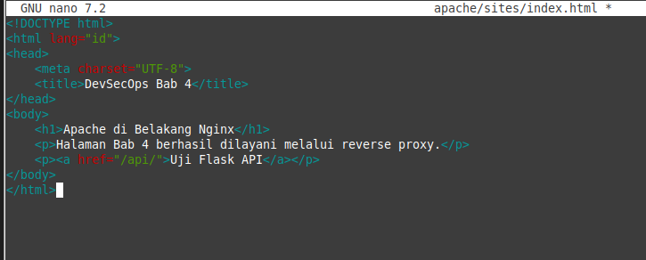

Penyediaan web statis ini menguji kapabilitas Apache HTTPD sebagai server internal yang bertugas melayani root endpoint (\`/\`). Pemasangan dokumen melalui \*bind mount read-only\* memastikan konten tetap terlindungi dari potensi modifikasi ilegal di runtime kontainer.

**6. File app/requirements.txt**

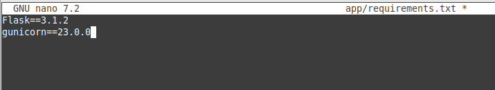

**7. File app/app.py**

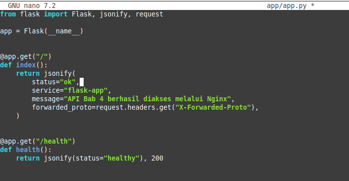

> Backend Python Flask dirancang untuk mengekstrak header X-Forwarded-Proto guna memvalidasi bahwa koneksi eksternal telah terenkripsi sebelum mencapai aplikasi. Penyediaan endpoint /health berfungsi sebagai pengujian yang secara berkala diuji oleh eksekutor kontainer untuk menjamin status ketersediaan layanan API.

**8. File app/Dockerfile**

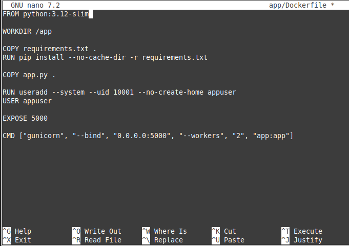

> Dockerfile ini menerapkan hardening sistem dengan base image minimalis python:3.12-slim untuk memangkas attack surface bawaan OS. Penetapan hak eksekusi kepada akun non-root appuser mitigasi risiko hak akses sistem jika proses aplikasi web berhasil dieksploitasi oleh penyerang.

**9. Validasi**

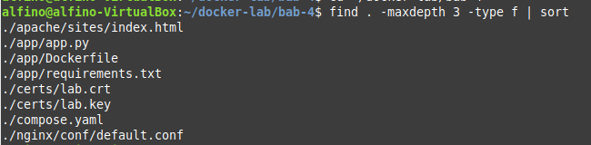

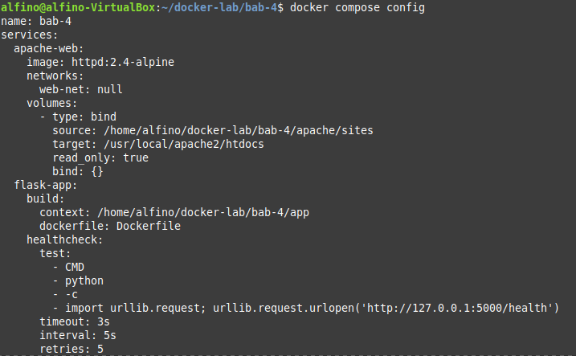

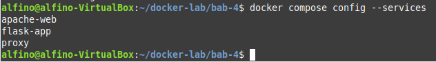

> Tahap verifikasi direktori ini memastikan keberadaan seluruh artefak dependensi sebelum eksekusi dimulai. Pemeriksaan sintaks via docker compose config memvalidasi parsing YAML dan resolusi service (proxy, apache-web, flask-app), mencegah kegagalan runtime akibat kesalahan struktur berkas.**\**

**10. Build dan Menjalankan Stack**

docker compose up -d –build

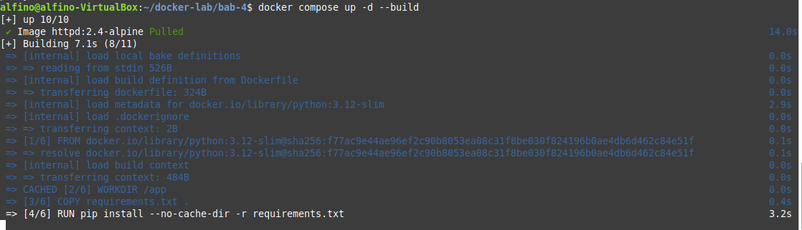

docker compose ps

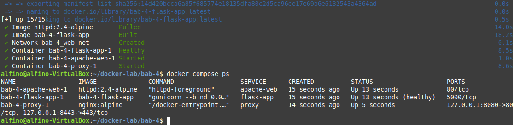

docker compose logs --tail 100

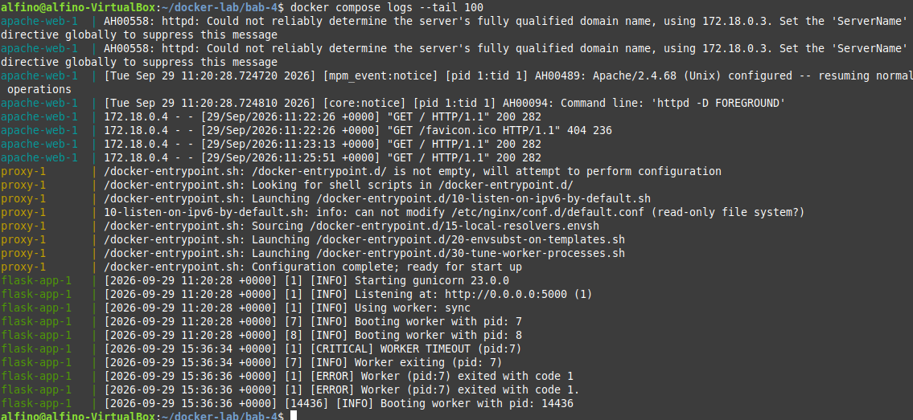

> Perintah up -d --build mengotomatisasi kompilasi image backend dan ketiga kontainer di latar belakang. Observasi status menunjukkan bahwa kontainer proxy dan apache-web berstatus Up, sementara flask-app mencapai status Up (healthy) setelah berhasil melewati tahapan verifikasi berkala pada rute kesehatannya.

**11. Pengujian Cepat**

> **\# HTTP harus redirect ke HTTPS**
>
> curl -I http://localhost:8080/
>
> 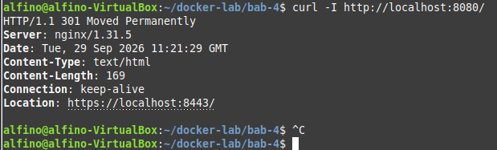
>
> 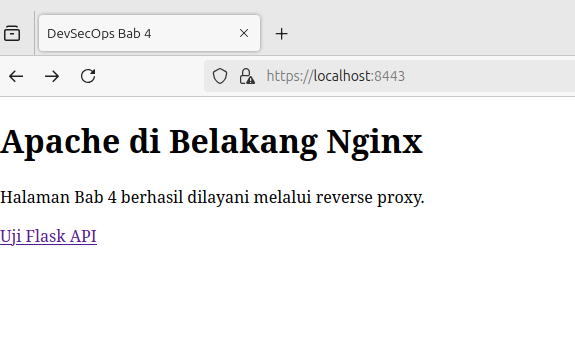
>
> **\# Halaman Apache melalui Nginx**
>
> curl -k -i https://localhost:8443/
>
> 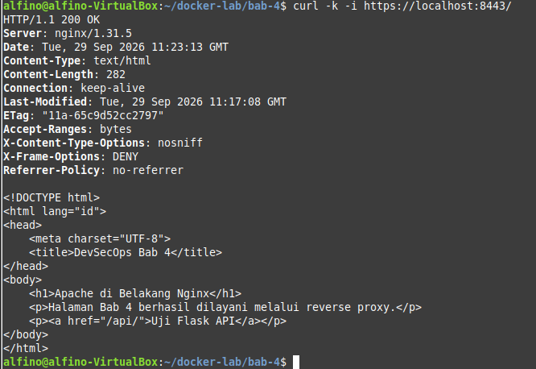
>
> **\# Flask API melalui Nginx**
>
> curl -k https://localhost:8443/api/
>
> 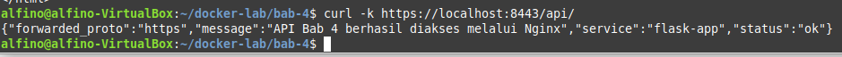
>
> **\# Health endpoint Flask**
>
> curl -k -i https://localhost:8443/api/health
>
> 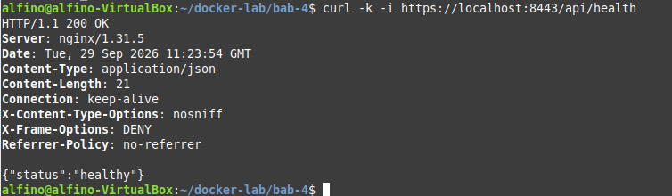
>
> **\# Informasi TLS**
>
> openssl s_client \\
>
> -connect localhost:8443 \\
>
> -servername localhost \\
>
> -brief \</dev/null
>
> 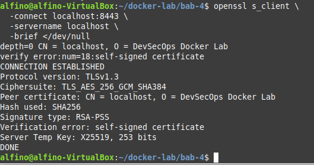
>
> Pengujian fungsional memvalidasi keberhasilan aturan pengalihan HTTP 301 ke HTTPS serta pemisahan rute proksi ke Apache (/) dan Flask (/api/). Negosiasi TLS yang diuji via openssl s_client membuktikan bahwa sertifikat digital berhasil digunakan dengan cipher suite aman pada protokol TLSv1.2/TLSv1.3.

**12. Pemeriksaan Isolasi**

> docker compose ps
>
> 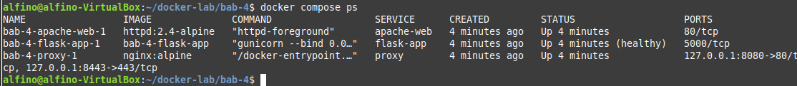
>
> docker network inspect bab-4_web-net
>
> 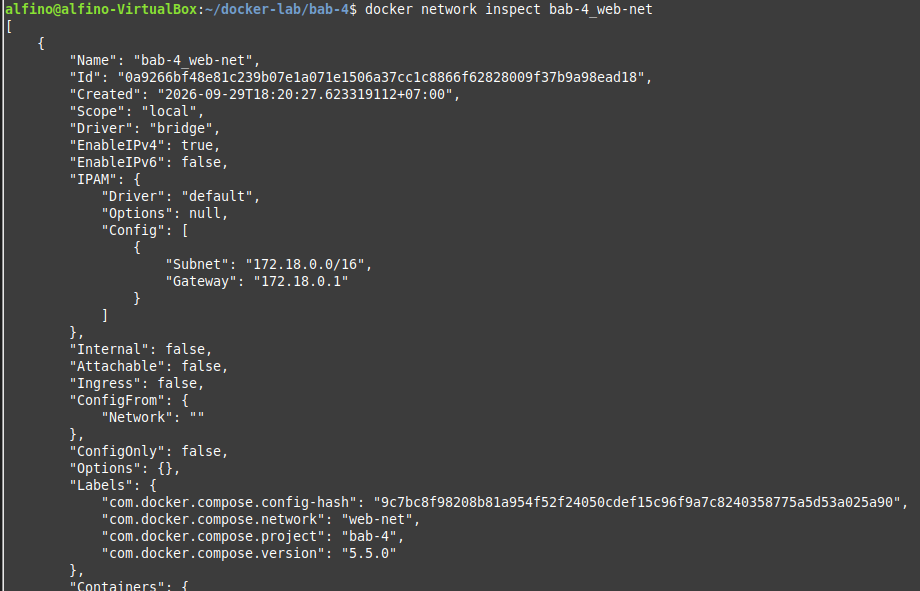
>
> docker compose exec proxy wget -qO- <http://apache-web/>
>
> 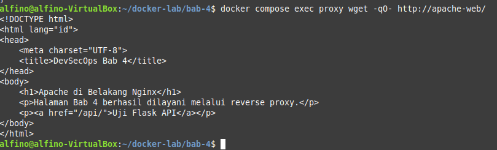
>
> docker compose exec proxy wget -qO- http://flask-app:5000/health
>
> 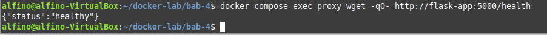
>
> Pengujian inspeksi membuktikan arsitektur perimeter security, di mana service backend tidak mengekspos port ke sistem host dan hanya dapat diakses melalui antarmuka internal web-net oleh Nginx. Uji pemanggilan wget dari dalam kontainer proksi memvalidasi efektivitas resolusi DNS internal Docker antar-layanan.

**13. Pemeriksaan Log Akses**

> docker compose logs proxy
>
> 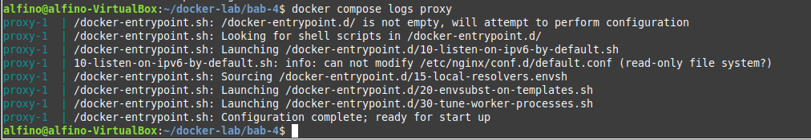
>
> docker compose logs apache-web
>
> 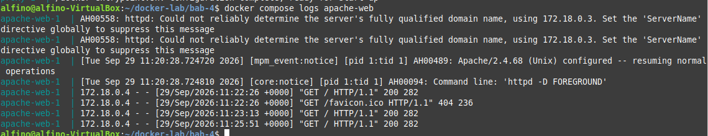
>
> docker compose logs flask-app
>
> 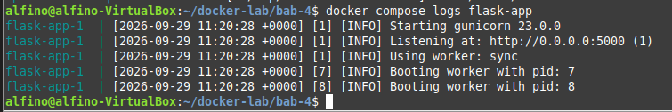
>
> tail -n 20 logs/nginx/access.log
>
> 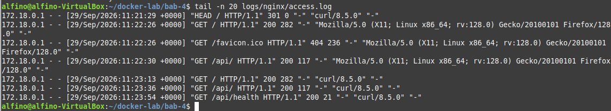
>
> tail -n 20 logs/nginx/error.log
>
> 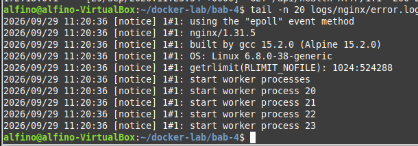
>
> Pemasangan direktori ./logs/nginx via bind mount membuktikan rekaman audit trafik web langsung pada level host. Seluruh jejak permintaan HTTPS klien tercatat secara runtut di access.log dengan kode status 200/301, mendukung kebutuhan observabilitas, forensik insiden, dan akuntabilitas operasional.

4.  **Checklist PASS**

- docker compose config tidak menghasilkan galat.

  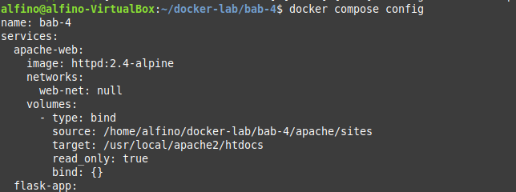

- flask-app berstatus healthy.

  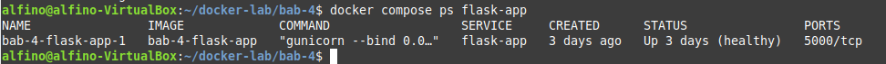

- HTTP port 8080 menghasilkan redirect 301.

  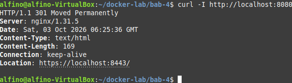

- HTTPS port 8443 menampilkan halaman Apache.

  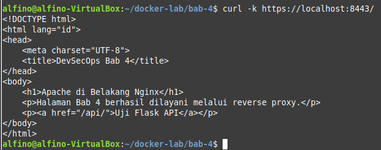

- /api/ menghasilkan JSON Flask.

  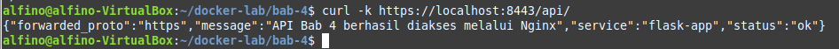

- TLS 1.2 atau TLS 1.3 berhasil dinegosiasikan.

  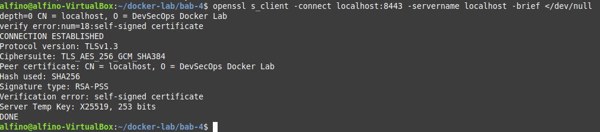

- Apache dan Flask tidak memiliki published port.

  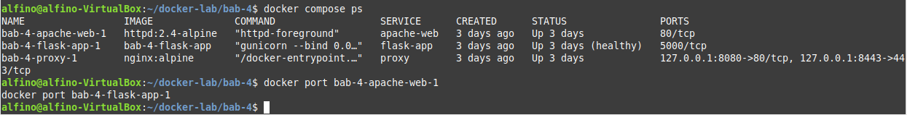

- Request tercatat pada access log Nginx.

  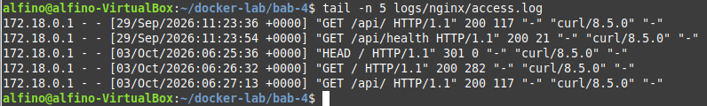

5.  Verifikasi dan Skenario Pengujian

<table>
<colgroup>
<col style="width: 16%" />
<col style="width: 30%" />
<col style="width: 41%" />
<col style="width: 11%" />
</colgroup>
<thead>
<tr>
<th><strong>Skenario Pengujian</strong></th>
<th><strong>Perintah</strong></th>
<th><strong>Output Keberhasilan</strong></th>
<th><strong>Status</strong></th>
</tr>
</thead>
<tbody>
<tr>
<td>Nginx reverse proxy dapat mengakses Apache melalui nama service.</td>
<td>docker compose exec proxy wget -qO- http://apache-web/</td>
<td>Mengembalikan dokumen HTML Apache di Belakang Nginx secara langsung via DNS internal.</td>
<td>Berhasil</td>
</tr>
<tr>
<td colspan="4" style="text-align: center;">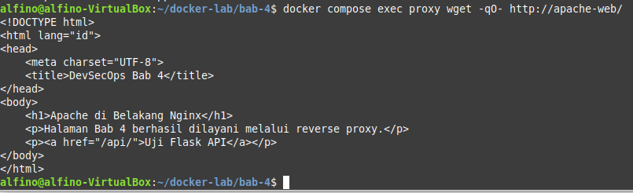</td>
</tr>
<tr>
<td>Endpoint /api diarahkan ke backend Flask.</td>
<td>curl -k https://localhost:8443/api/</td>
<td>enghasilkan respons JSON: {"forwarded_proto":"https","message":"API Bab 4 berhasil...","service":"flask-app","status":"ok"}</td>
<td>Berhasil</td>
</tr>
<tr>
<td colspan="4">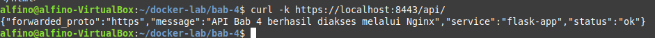</td>
</tr>
<tr>
<td>HTTPS self-signed berjalan di port 8443</td>
<td>openssl s_client -connect localhost:8443 -servername localhost -brief &lt;/dev/null</td>
<td>Koneksi TLS berhasil terjalin (CONNECTION ESTABLISHED) menggunakan protokol TLSv1.2 atau TLSv1.3.</td>
<td>Berhasil</td>
</tr>
<tr>
<td colspan="4" style="text-align: center;">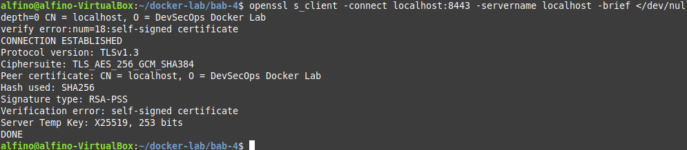</td>
</tr>
<tr>
<td>Access log tersimpan di direktori host.</td>
<td>tail -n 10 logs/nginx/access.log</td>
<td>Berkas di host menampilkan entri rekaman IP 127.0.0.1, method HTTP, path URL, dan status code 200/301.</td>
<td>Berhasil</td>
</tr>
<tr>
<td colspan="4">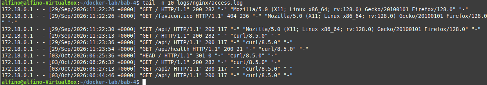</td>
</tr>
</tbody>
</table>

6.  Jawaban Evaluasi dan Latihan Mandiri

<!-- -->

1.  **Mengapa reverse proxy tidak seharusnya menjalankan semua logic aplikasi?\**
    Pemisahan ini didasarkan pada prinsip pemisahan tanggung dan arsitektur konkurensi. Reverse proxy seperti Nginx menggunakan arsitektur event-driven non-blocking yang dirancang khusus untuk menangani ribuan koneksi I/O secara cepat (seperti terminasi TLS dan mitigasi DDoS dasar). Menjalankan logika bisnis, pemrosesan transaksi, atau komputasi database pada reverse proxy akan memblokir worker process, menghabiskan memori, serta memperluas permukaan serangan di perimeter terluar sistem. Pemisahan ini memungkinkan layer backend diskalakan secara independen tanpa mengganggu stabilitas ingress gateway.

2.  **Apa perbedaan TLS termination dan end-to-end TLS?**

- Enkripsi TLS didekripsi di lapisan terluar, yaitu pada reverse proxy. Komunikasi dari reverse proxy menuju layanan backend di jaringan internal menggunakan protokol plaintext. Keuntungannya adalah penghematan beban komputasi CPU di backend dan sentralisasi manajemen sertifikat, namun terdapat risiko jika jaringan internal host berhasil disadap penyerang.

- End-to-End TLS: Enkripsi dipertahankan secara utuh mulai dari browser klien hingga mencapai kontainer backend terdalam. Proxy hanya bertindak sebagai TCP passthrough atau melakukan re-encryption (TLS di-dekripsi lalu di-enkripsi ulang dengan sertifikat internal baru). Pola ini wajib diterapkan pada standar arsitektur Zero-Trust, atau multi-tenant cluster yang tidak mengasumsikan jaringan internal sebagai area aman.

3.  **Bagaimana cara mengisolasi backend agar tidak langsung diakses dari host?**

> Isolasi dilakukan dengan tidak mendefinisikan blok ports (misalnya "5000:5000" atau "80:80") pada service backend di compose.yaml. Layanan backend hanya didaftarkan ke dalam user-defined bridge network internal (misalnya networks: \[web-net\]). Dengan ini, Docker Engine tidak akan membuat aturan NAT/iptables pada antarmuka host, sehingga port backend tidak pernah terbuka ke dunia luar maupun loopback host. Akses ke backend secara fisik dibatasi dan hanya dapat dicapai melalui resolusi DNS internal oleh kontainer yang berada di dalam jaringan virtual yang sama.

4.  **Apa konsekuensi menyimpan private key TLS di bind mount?**

- Keamanan berkas private key bergantung penuh pada kontrol akses berkas di mesin host. Jika berkas tidak diatur dengan hak ketat (chmod 600), pengguna lain atau proses non-privilese di mesin host dapat membaca berkas kunci privat tersebut. Lalu jika direktori bind mount tidak dipasang dengan atribut read-only (:ro), kontainer yang mengalami celah keamanan dapat memanipulasi, mengganti, atau menghapus sertifikat tersebut dari dalam kontainer.

5.  **Bandingkan log Nginx dan log Apache dari sisi format dan kegunaan debugging!**

- Log Nginx :

  - Secara default menggunakan format combined yang ringkas, satu baris per request (mencakup IP klien, identitas user, timestamp, HTTP request line, status code, bytes sent, referrer, dan user-agent).

  - Nginx unggul untuk melacak metrik proxy melalui variabel tambahan seperti \\(upstream_status, \\)upstream_response_time, dan upstream_connect_time. Hal ini memudahkan operator mendeteksi apakah kelambatan atau galat 502/504 bersumber dari Nginx sendiri atau dari server backend yang lambat merespons.

- Log Apache :

  - Memisahkan access_log dan error_log dengan struktur penandaan modul eksplisit yang mencantumkan level severitas (seperti \[module:severity\] \[pid X:tid Y\] \[client IP:port\] pesan rincian).

  - Apache error log jauh lebih deskriptif untuk mendiagnosis masalah internal aplikasi tingkat rendah, seperti kegagalan modul CGI, parsing berkas konfigurasi, penolakan akses akibat aturan .htaccess, atau kesalahan izin baca direktori fisik document root.
