**LAPORAN WORKSHOP 5**

**Workshop DevOps**

Database Service di Docker: PostgreSQL.

> Nama : Alfino Dwi Rahmatullah – 3126640027
>
> Kelas : RPL LJ Teknik Informatika B
>
> Dosen : Dr. Ferry Astika Saputra, ST, M.Sc.

Politeknik Elektronika Negeri Surabaya

Departemen Teknik Informatika dan Komputer

Program Studi Teknik Informatika

2026

1.  Pendahuluan

    Penugasan praktikum ini berfokus pada dua modul, yaitu Bab 5 sebagai teori dan Bab 5 Cheatsheet (CS) sebagai acuan praktikum. Modul Bab 5 dijadikan rujukan pemahaman konsep database service sebagai sistem persisten, kelola keamanan kredensial, segmentasi eksposur jaringan, mekanisme inisialisasi skema otomatis pada entrypoint, serta siklus hidup pemulihan data (durability, backup, dan restore). Sementara itu, seluruh tahapan teknis langkah demi langkah mulai dari penyiapan struktur direktori, pemisahan konfigurasi lingkungan dengan izin akses berkas .env (chmod 600) dan filter .gitignore, penulisan compose.yaml berbasis healthcheck pg_isready, injeksi skema awal via init/01-schema.sql, pra-registrasi konfigurasi server pgAdmin, pembuatan skrip penbackup berintegritas checksum SHA-256 (backup.sh), pelaksanaan uji restore-test.sh, pembuktian persistensi named volume (pg-data), hingga observabilitas metrik performa database melalui antarmuka web pgAdmin4 dikerjakan secara penuh mengikuti instruksi cheatsheet (bab-05-cs.md).

2.  Langkah Praktikum Eksploratif

    Struktur File :

    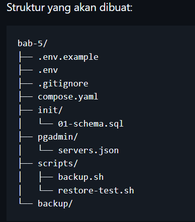

> **Langkah 1: Menyiapkan Direktori Kerja Bab 5**
>
> 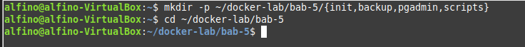
>
> **Analisis:** Untuk membuat direktori dan subdirektori yang sudah kita tentukan, dan masuk ke direktori bab-5 yang sudah kita buar.
>
> **Langkah 2: Membuat File .env.example**
>
> 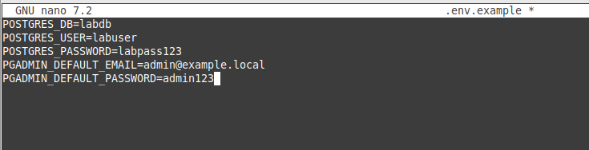
>
> **Analisis:** Perintah ini membuat *blueprint* yang mendefinisikan parameter konfigurasi dasar tanpa mengekspos kredensial.
>
> **Langkah 3: Mengaktifkan Konfigurasi .env dan Menerapkan Pembatasan Hak Akses**
>
> 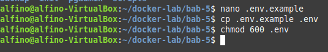
>
> **Analisis:** File .env memudahkan interpolasi Compose, tetapi bukan secret manager. Jangan gunakan nilai laboratorium ini pada sistem produksi. Dan kegunaanya agar konfigurasi aktif
>
> **Langkah 4: Membuat file .gitignore**
>
> 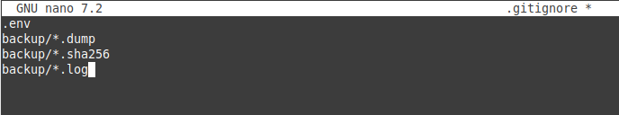
>
> **Analisis:** file ini mengurangi risiko credential dan dump terkirim ke Git.
>
> **Langkah 5: Membuat file compose.yaml**
>
> 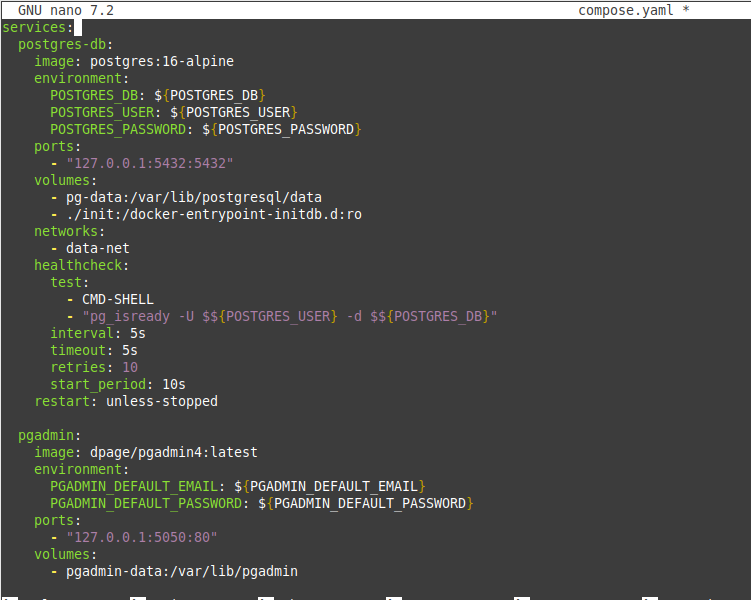
>
> **Analisis:** Berkas ini sebagai service postgres-db dan pgadmin di dalam jaringan privat data-net dengan port yang dibatasi hanya pada *loopback* (127.0.0.1) host
>
> **Langkah 6: Membuat Skrip Database (init/01-schema.sql)**
>
> 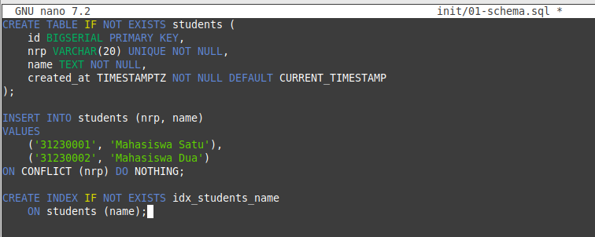
>
> **Analisis:** Perintah ini mendefinisikan skema tabel students beserta indeks pencarian yang akan otomatis dieksekusi oleh PostgreSQL saat kontainer pertama kali membuat volume data kosong.
>
> **Langkah 7: Membuat Berkas pgAdmin (pgadmin/servers.json)**
>
> 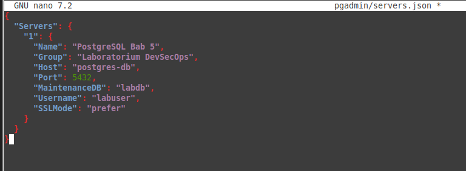
>
> **Analisis:** Berkas JSON ini memuat koneksi otomatis ke instance database di dalam kontainer pgAdmin dengan merujuk alamat host internal postgres-db via DNS bawaan Docker bridge. Hostname pgAdmin harus menggunakan postgres-db, bukan localhost, karena pgAdmin berjalan dalam container berbeda. Di dalam container pgAdmin, localhost berarti container pgAdmin itu sendiri.
>
> **Langkah 8: Membuat Otomatis Backup (scripts/backup.sh)**
>
> 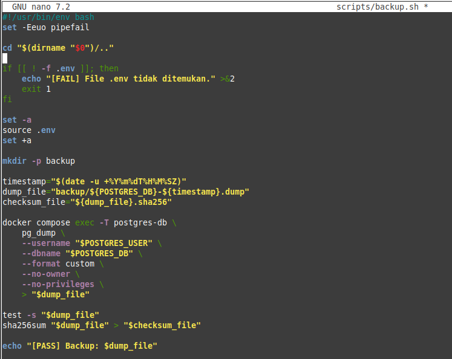
>
> **Analisis:** Skrip bash ini mengotomatisasi backup menggunakan pg_dump berformat biner *custom* (-Fc) non-interaktif tanpa menyertakan atribut kepemilikan host.
>
> **Langkah 9: Membuat Skrip test restore (scripts/restore-test.sh)**
>
> 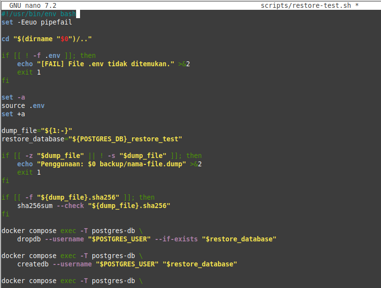
>
> **Analisis:** Skrip ini mengimplementasikan pengujian restore dengan memvalidasi *checksum* SHA-256 berkas backup sebelum melakukan impor data via pg_restore ke database terpisah (labdb_restore_test).
>
> **Perintah B — Permission dan Validasi File**
>
> **Langkah 10: Memberikan Izin dan Langkah 11: Memeriksa Kelengkapan Berkas**
>
> 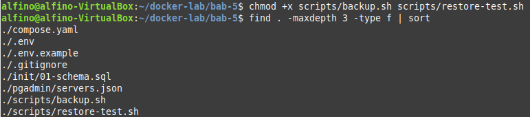
>
> **Analisis:** Perintah inspeksi direktori ini memindai dan mengurutkan seluruh berkas fisik hingga tiga subdirektori untuk memastikan tidak ada konfigurasi yang tertinggal sebelum deployment dimulai.
>
> **Langkah 12: Konfigurasi Docker Compose**
>
> 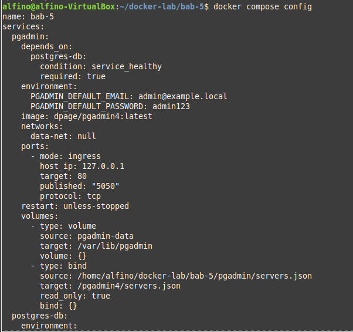
>
> **Analisis:** Tampilnya deklarasi Compose tanpa error sintaks memastikan seluruh parameter volume, port, dan network telah tervalidasi secara benar sebelum kontainer dijalankan.
>
> **Langkah 13: Memeriksa Daftar Layanan Compose**
>
> 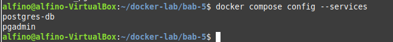
>
> **Analisis:** Output service sudah sesuai dengan yang diharapkan dari yang tercantum di materi bab-05-cs
>
> **Langkah 14: Menjalankan Stack Kontainer**
>
> 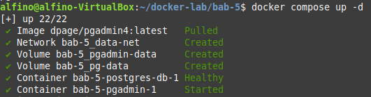
>
> **Langkah 15: Memantau Status Siklus Hidup Kontainer**
>
> 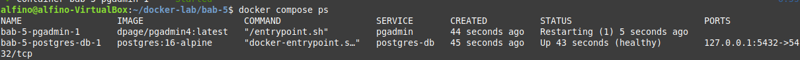
>
> 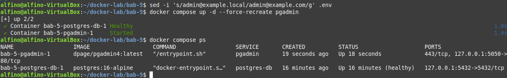
>
> **Analisis:** Awalnya kontainer pgAdmin terus-meneru restarting karena sistem pgAdmin secara otomatis menolak alamat email admin@example.local pada konfigurasi .env, di mana akhiran domain .local dianggap tidak valid oleh bawaan aplikasi. Masalah ini berhasil diatasi dengan mengganti akhiran domain email tersebut menjadi domain standar .com (admin@example.com) melalui perintah sed, lalu kontainer dimuat ulang menggunakan perintah docker compose up -d --force-recreate pgadmin. Setelah diterapkan, kontainer pgAdmin langsung berjalan normal dengan status Up dan port 5050 berhasil terhubung sehingga halaman web dapat diakses dengan lancar.
>
> **Langkah 16: Memeriksa Catatan Log Startup Database**
>
> 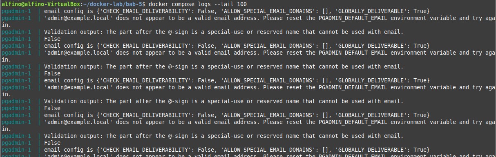
>
> **Analisis:** Perintah diagnostik ini membaca 100 baris record peristiwa terakhir dari seluruh container, dan disana terdapat error karena Penyebabnya sudah terkonfirmasi jelas dari log: pgAdmin menolak domain .local pada admin@example.local karena dianggap sebagai *reserved domain* oleh validator email bawaan Python di pgAdmin dan sudah solved.
>
> Login localhost:5050
>
> 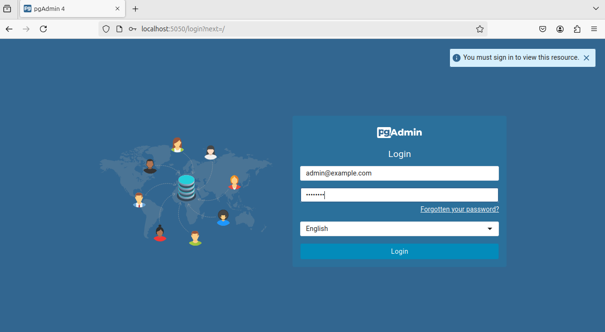
>
> Password : labpass123
>
> 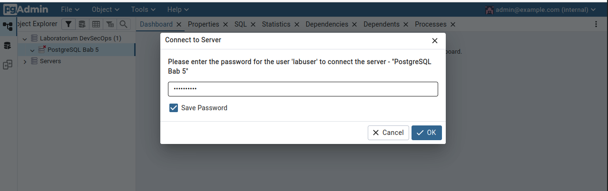
>
> 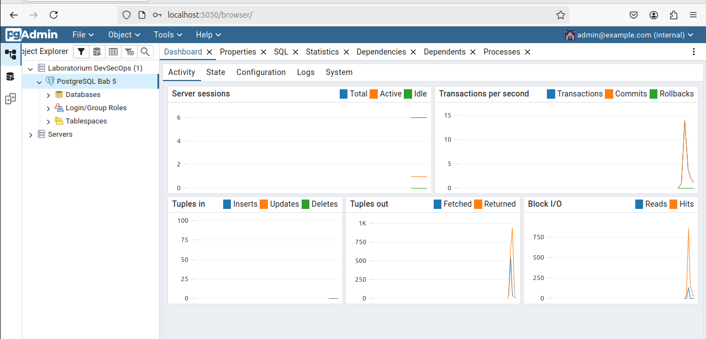
>
> 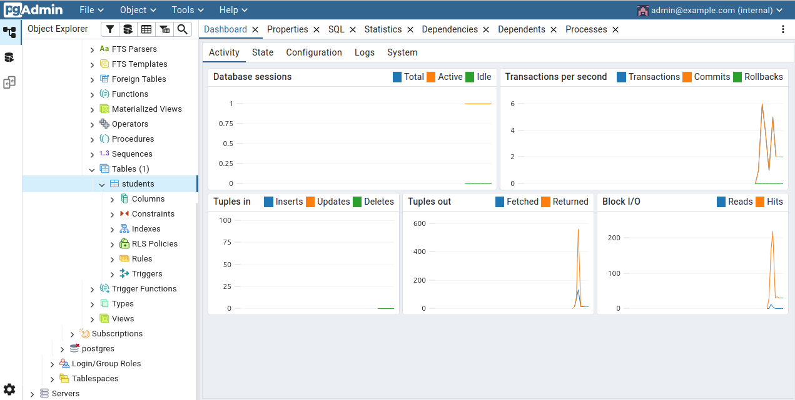
>
> **Analisa :** Database student sudah tampil di halaman web pg-admin
>
> **Langkah 17: Verif Pembuatan Tabel Skema**
>
> 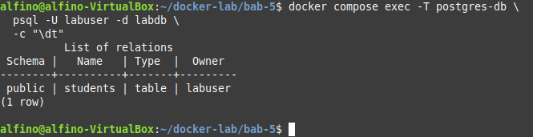
>
> **Analisis:** Eksekusi perintah psql \dt di dalam kontainer database untuk menginspeksi daftar relasi tabel publik. Tampilnya tabel students dengan tipe data tabel reguler membuktikan bahwa berkas init/01-schema.sql telah berhasil dijalankan secara otomatis saat volume pertama kali dibentuk.
>
> **Langkah 18: Memverifikasi Data Awal Mahasiswa**
>
> 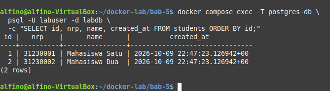
>
> **Analisis:** Perintah kueri SQL ini membaca seluruh data pada tabel students untuk memastikan data awal.
>
> **Langkah 19: Menyisipkan Data Baru**
>
> 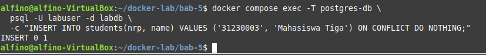
>
> **Analisis:** Perintah ini mengeksekusi kueri penambahan baris data baru untuk state penyimpanan database. Penambahan entitas 'Mahasiswa Tiga' (NRP 31230003).
>
> **Langkah 20: Menghentikan dan Menghapus Kontainer Database**
>
> 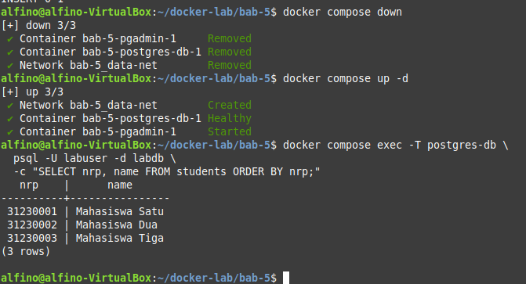
>
> **Analisis:** Perintah ini menghentikan seluruh proses aplikasi dan menghapus kontainer serta jaringan virtual data-net tanpa menyertakan -v. Ketiadaan flag tersebut menjamin named volume pg-data tetap dipertahankan utuh pada filesystem mesin host Linux.
>
> **Langkah 21: Menyalakan Kembali Stack Kontainer & Langkah 22: Membuktikan Persistensi Data pada Volume**
>
> 
>
> **Analisis:** Perintah ini mengeksekusi kueri seleksi untuk memeriksa data setelah docker hidup kontainer diperbarui. Masih tersedianya baris data 31230003 bersama data awal membuktikan bahwa penyimpanan database bersifat persisten dan siklus hidup data terpisah sepenuhnya dari siklus hidup kontainer.
>
> **Langkah 23: Menjalankan Automasi (Backup) & Langkah 24: Memeriksa Metadata Berkas Backup di Host & Langkah 25: Memverifikasi Integritas Checksum Berkas Backup**
>
> 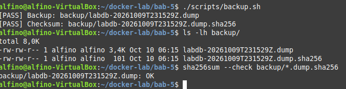
>
> **Analisis:** Perintah ini menampilkan berkas di dalam direktori backup/ lengkap dengan atribut ukuran kapasitas penyimpanannya.
>
> **Langkah 26: Restore Test & Langkah 27: Menjalankan Uji restore**
>
> 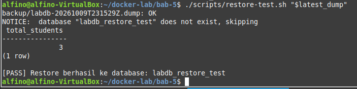
>
> **Analisis:** Eksekusi skrip restorasi yang secara otomatis membuat database terisolasi labdb_restore_test dan memulihkan seluruh skema beserta datanya dari berkas dump terpilih.
>
> **Langkah 28: Periksa database hasil restore**
>
> 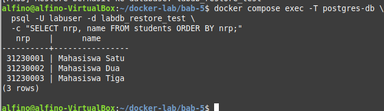
>
> **Langkah 29: Monitoring Dasar PostgreSQL**
>
> 
>
> 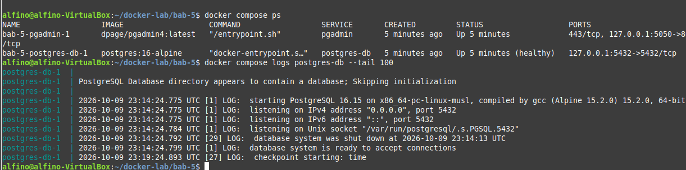
>
> **Langkah 30: Memeriksa Versi Mesin PostgreSQL**
>
> 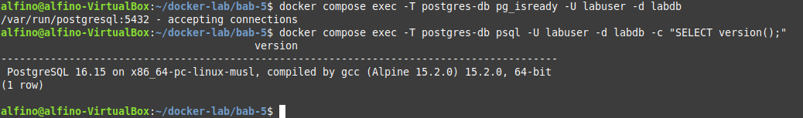
>
> **Analisis:** Perintah ini mengambil informasi versi resmi PostgreSQL beserta arsitektur kompilasi sistem operasi Alpine Linux di dalamnya.
>
> **Langkah 31: Menginspeksi Daftar Volume Docker**
>
> 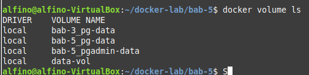
>
> **Analisis:** Menampilkan daftar seluruh penyimpanan persisten yang dikelola langsung oleh Docker Engine pada host.
>
> **Langkah 32: Memeriksa Penggunaan Kapasitas Disk Kontainer**
>
> 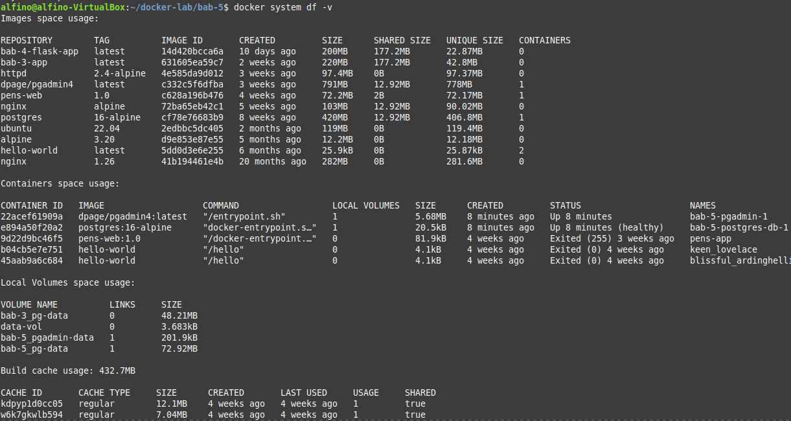
>
> **Analisis:** Perintah ini menyajikan rincian konsumsi ruang disk yang digunakan oleh image, kontainer aktif, named volume, dan build cache secara mendalam.
>
> **Langkah 33: Bersihkan Database Uji Pemulihan**
>
> 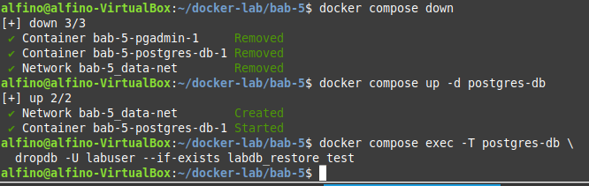
>
> **Analisis:** Perintah ini menghapus database labdb_restore_test yang sebelumnya digunakan untuk pengujian restorasi berkas backup. Pembersihan database sementara ini merupakan praktik operasional yang baik guna mengembalikan alokasi memori dan ruang penyimpanan tanpa memengaruhi basis data utama labdb.
>
> **Langkah 34: Menghentikan Lingkungan Praktikum Secara Bersih****Analisis:** Perintah ini mematikan seluruh kontainer dan jaringan kerja Bab 5 tanpa menyertakan opsi -v.

3.  **Checklist PASS**

- docker compose config tidak menghasilkan galat.

  

- PostgreSQL berstatus healthy.

  

- Tabel students dan data awal tersedia.

  

- pgAdmin dapat terhubung menggunakan hostname postgres-db.

  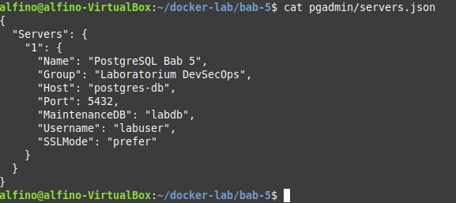

- Data tetap tersedia setelah docker compose down dan up.

  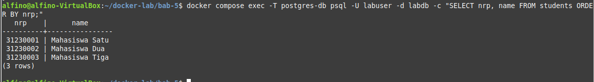

- Backup dump berukuran lebih dari nol.

  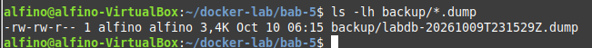

- Checksum backup valid.

  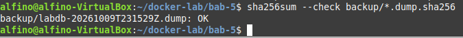

- Restore berhasil pada database labdb_restore_test.

- Credential dan dump tidak masuk repository Git.

  

4.  **Jawaban Evaluasi dan Latihan Mandiri**

<!-- -->

1.  **Mengapa init script tidak dijalankan ulang saat volume lama masih ada?**

    Skrip inisialisasi pada folder /docker-entrypoint-initdb.d dirancang oleh PostgreSQL hanya berjalan satu kali saat direktori data benar-benar masih kosong. Jika volume lama sudah berisi data, PostgreSQL sengaja melewati skrip tersebut untuk mencegah terjadinya penimpaan data, duplikasi data, atau kerusakan skema yang sudah aktif digunakan.

2.  **Apa risiko menaruh password database pada docker-compose.yml?**

    Kata sandi tersimpan dalam format teks biasa yang sangat rentan bocor. Siapa pun yang memiliki akses ke server dapat melihat kata sandi tersebut secara langsung melalui perintah docker inspect, riwayat proses sistem, atau jika berkas konfigurasi tersebut tidak sengaja terunggah ke repositori Git publik.

3.  **Bagaimana cara membuktikan backup dapat dipulihkan?**

    Dengan melakukanrestore test ke database terpisah (labdb_restore_test), bukan hanya sekadar memastikan berkas dump berhasil dibuat. dibuktikan ketika nilai checksum SHA-256 valid dan jumlah baris data yang dipulihkan cocok persis dengan data aslinya.

4.  **Apa bedanya logical backup pg_dump dan backup filesystem volume mentah?\
    Logical Backup (pg_dump):** Menyimpan data dalam bentuk struktur logika atau kueri SQL.\
    **Filesystem Backup (Volume Mentah):** Menyalin seluruh berkas fisik penyimpanan database apa adanya.

5.  **Apa dampak docker compose down -v terhadap database?**

    Opsi -v (volume) akan menghapus kontainer sekaligus named volume persisten (pg-data). Dampaknya, seluruh basis data, tabel, dan data transaksi yang tersimpan di dalamnya akan terhapus permanen dari sistem host.

    **Notes :** Penggunaan AI disini untuk membantu menganalisis dalam melakukan langkah praktikum di VM Linux, untuk troubleshoot error saat menjalankan langkah praktikum. Dan penyusunan laporan untuk membantu merapikan agar laporan lebih rapi.
