**LAPORAN WORKSHOP 6**

**Workshop DevOps**

Centralized Logging dengan Fluent Bit dan Postgre SQL

Skenario Logging App PMB DevOps

> Nama : Alfino Dwi Rahmatullah – 3126640027
>
> Kelas : RPL LJ Teknik Informatika B
>
> Dosen : Dr. Ferry Astika Saputra, ST, M.Sc.

Politeknik Elektronika Negeri Surabaya

Departemen Teknik Informatika dan Komputer

Program Studi Teknik Informatika

2026

1.  Pendahuluan

    Penugasan ini berpatokan pada dua modul, yaitu Bab 6 sebagai teori dan Bab 6 Cheatsheet (CS) sebagai patokan praktikum. Modul Bab 6 dijadikan rujukan pemahaman konsep centralized logging dan observability pada lingkungan kontainer, arsitektur pipeline Fluent Bit (input, parser, filter, buffer, dan output), pemanfaatan PostgreSQL dengan kolom JSONB beserta kebijakan retensi, penanganan terhadap backpressure, serta penempatan log sebagai bukti dan produk data. Sementara itu, seluruh tahapan teknis langkah demi langkah mulai dari penyiapan struktur direktori kerja, konfigurasi lingkungan dengan izin akses berkas .env dan filter .gitignore, compose.yaml berbasis healthcheck pg_isready pada jaringan internal logging-net beserta tiga kontainer log generator (generator-auth, generator-api, generator-worker) yang menggunakan Docker fluentd logging driver, inisialisasi otomatis role khusus ingest, skema logs, tabel logs.fluentbit bertipe JSONB, indeks GIN, dan view logs.recent_logs via init/01-init-logging.sh.

2.  Langkah Praktikum Eksploratif

    Struktur File :

    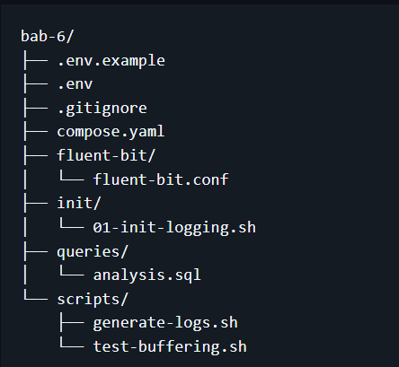

> **Kotak Perintah A Menyiapkan Direktori Bab 6**
>
> **1. Membuat struktur direktori praktikum**
>
> 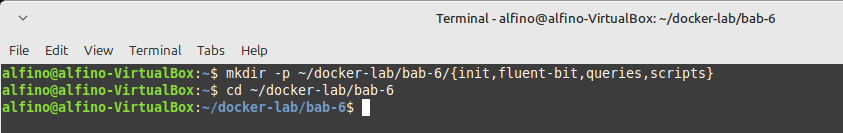

- **Analisis:** Perintah ini menggunakan *brace expansion* dan opsi -p untuk membuat direktori utama bab-6 beserta empat subdirektori (init, fluent-bit, queries, scripts) sekaligus tanpa kesalahan jika folder sudah ada. Pemisahan direktori ini menjaga kerapian berkas konfigurasi, volume *bind mount*, dan laporan praktikum.

> **2. Berpindah ke direktori kerja**
>
> 

- **Analisis:** Perintah ini mengarahkan sesi terminal aktif ke dalam folder ~/docker-lab/bab-6 sebagai direktori kerja utama. Hal ini memastikan seluruh pemanggilan perintah pembuatan berkas dan referensi *path* relatif pada Docker Compose berjalan di lokasi yang tepat.

> **Kotak Script 1 File .env.example dan Aktivasi .env**
>
> **3. Membuat dan mengisi file template .env.example**
>
> 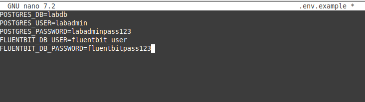

- **Analisis:** Perintah nano .env.example membuka editor teks untuk membuat templat parameter lingkungan yang memisahkan akun administrator database (labadmin) dari akun khusus penulis log (fluentbit_user) sesuai prinsip pemisahan hak akses. Pemusatan variabel ini mencegah penulisan kredensial secara langsung di dalam berkas compose.yaml.

> **4. Menyalin template menjadi file .env aktif**
>
> 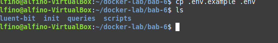

- **Analisis:** Perintah ini menggandakan berkas templat .env.example menjadi berkas .env lokal yang akan dibaca secara otomatis oleh Docker Compose saat melakukan interpolasi variabel lingkungan.

> **5. Membatasi hak akses file .env**
>
> 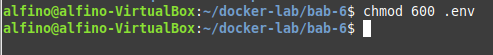

- **Analisis:** Perintah ini mengatur izin berkas .env hanya pengguna pemilik di host yang dapat membaca dan mengubah isinya. Langkah ini menerapkan prinsip keamanan dasar untuk melindungi kredensial lokal agar tidak dapat dibaca oleh pengguna lain di sistem yang sama.

> **Kotak Script 2 File .gitignore**
>
> **6. Membuat file .gitignore**
>
> 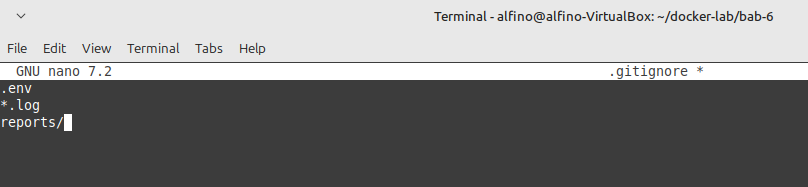

- **Analisis:** Perintah nano .gitignore membuat daftar pengecualian Git agar berkas .env, berkas catatan \*.log, serta folder reports/ tidak ikut terlacak atau tidak sengaja ter-commit ke dalam repositori.

> **Kotak Script 3 File compose.yaml**
>
> **7. Membuat file compose.yaml**
>
> 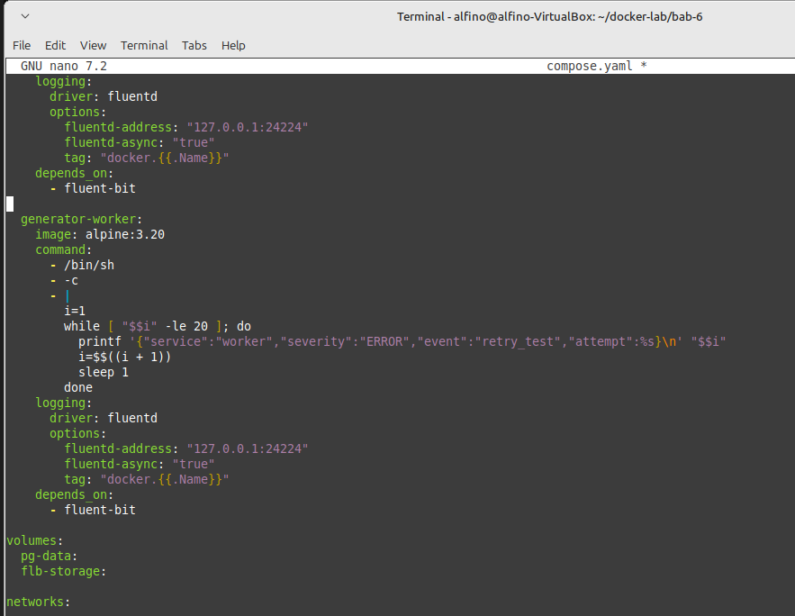

- **Analisis:** Perintah nano compose.yaml mendefinisikan arsitektur 5 kontainer: postgres-db (tanpa ekspos port ke host demi isolasi jaringan), fluent-bit (kunci port input 24224 dan metrik 2020 khusus ke loopback 127.0.0.1 serta memakai no-new-privileges:true), dan 3 kontainer generator (auth, api, worker). Ketiga generator memakai *Docker fluentd logging driver* dengan opsi fluentd-async: "true" ke 127.0.0.1:24224 agar kegagalan *collector* tidak memblokir pembuatan kontainer.

> **Kotak Script 4 File init/01-init-logging.sh**
>
> **8. Membuat skrip inisialisasi database init/01-init-logging.sh**
>
> 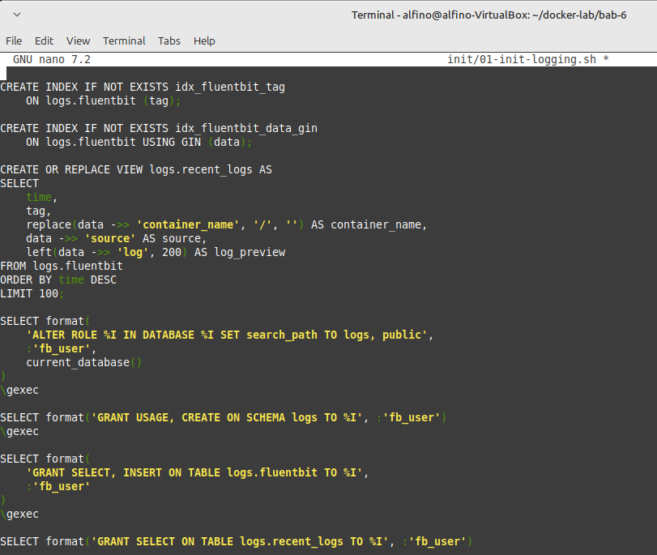

- **Analisis:** Perintah nano init/01-init-logging.sh menyiapkan skrip *entrypoint* PostgreSQL yang secara otomatis membuat role khusus fluentbit_user, skema logs, tabel logs.fluentbit dengan kolom data bertipe JSONB, indeks pencarian (termasuk indeks GIN untuk JSONB), serta view logs.recent_logs. Skrip ini juga menyetel search_path akun fluentbit_user ke skema logs dan membatasi izin tabel hanya pada SELECT dan INSERT tanpa hak hapus data.

> **Kotak Script 5 File fluent-bit/fluent-bit.conf**
>
> **9. Membuat file konfigurasi fluent-bit/fluent-bit.conf**
>
> 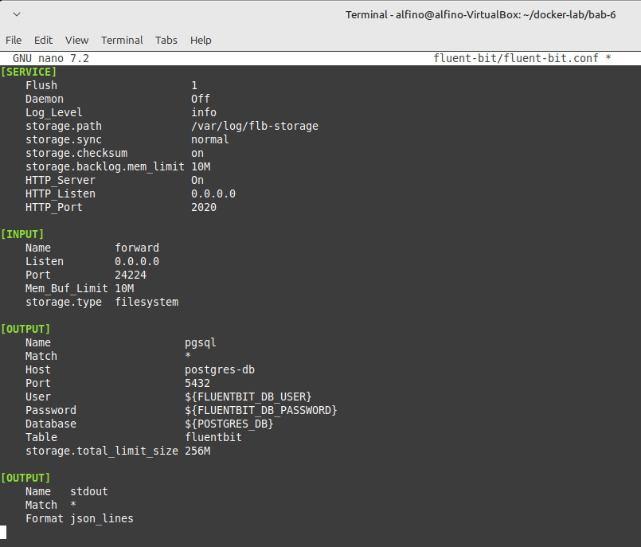

- **Analisis:** Perintah nano fluent-bit/fluent-bit.conf mengatur pipeline Fluent Bit untuk menerima log via protokol Forward di port 24224, mengaktifkan server HTTP monitoring di port 2020, serta menerapkan *filesystem buffering* di /var/log/flb-storage (hingga 256 MB) agar antrean log aman saat database mati sementara. Seluruh log dikirim secara paralel ke tabel fluentbit di PostgreSQL menggunakan plugin pgsql dan ke stdout dalam format baris JSON.

> **Kotak Script 6 File queries/analysis.sql**
>
> **10. Membuat kumpulan query analisis queries/analysis.sql**
>
> 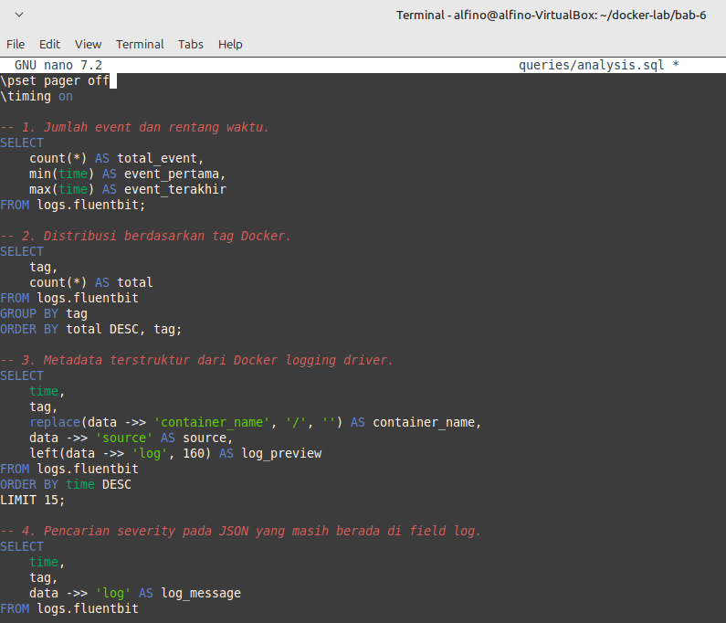

- **Analisis:** Perintah nano queries/analysis.sql menyimpan lima kueri verifikasi untuk menghitung total event, mengelompokkan distribusi log per tag kontainer, mengekstrak metadata JSONB (container_name, source, log), memfilter pesan berlevel ERROR, dan menghitung laju log per menit. Berkas ini juga memuat contoh kueri retensi penghapusan log yang berusia lebih dari 7 hari.

> **Kotak Script 7 File scripts/generate-logs.sh**
>
> **11. Membuat skrip log scripts/generate-logs.sh**
>
> 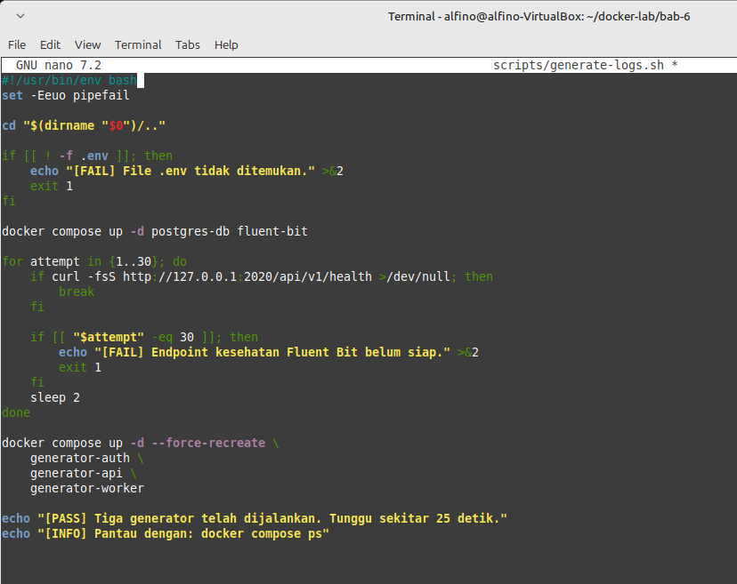

- **Analisis:** Perintah nano scripts/generate-logs.sh membuat skrip otomatisasi yang menyalakan postgres-db dan fluent-bit terlebih dahulu, lalu melakukan *polling* ke endpoint /api/v1/health hingga Fluent Bit benar-benar siap menerima trafik. Setelah collector sehat, skrip membuat ulang ketiga kontainer generator agar masing-masing mengirimkan 20 baris log JSON uji.

> **Kotak Script 8 File scripts/test-buffering.sh**
>
> **12. Membuat skrip scripts/test-buffering.sh**
>
> 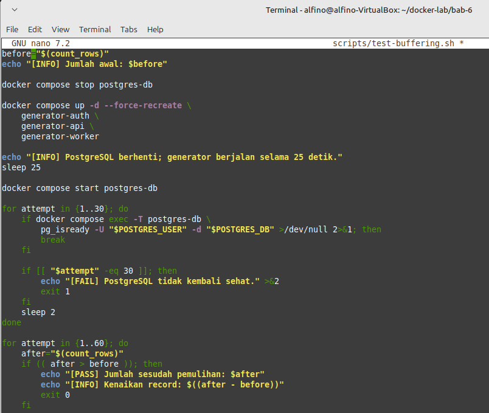

- **Analisis:** Perintah nano scripts/test-buffering.sh membuat skrip pengujian dan pemulihan dengan cara mencatat jumlah baris awal, mematikan postgres-db, dan menjalankan ketiga generator saat database mati. Skrip kemudian menyalakan kembali PostgreSQL dan memverifikasi bahwa jumlah record bertambah karena Fluent Bit menyalurkan simpanan backlog dari buffer filesystem.

> **Kotak Perintah B Memberi Izin Eksekusi dan Memvalidasi Berkas**
>
> **13. Memberi izin eksekusi pada skrip inisialisasi DB**
>
> 

- **Analisis:** Perintah ini menambahkan bit izin eksekusi (+x) pada berkas 01-init-logging.sh. Tanpa izin eksekusi ini, mekanisme entrypoint kontainer PostgreSQL tidak akan mengeksekusi skrip shell tersebut saat inisialisasi volume pertama kali.

> **14. Memberi izin eksekusi pada skrip pengujian**
>
> 

- **Analisis:** Perintah ini memberikan hak eksekusi pada kedua skrip di folder scripts/ agar dapat dijalankan langsung menggunakan pemanggilan ./scripts/\<nama-script\>.sh dari terminal.

> **15. Memeriksa sintaks skrip inisialisasi DB**
>
> 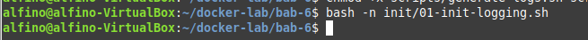

- **Analisis:** Perintah bash -n melakukan pengecekan sintaks pada skrip 01-init-logging.sh tanpa benar-benar mengeksekusi perintah di dalamnya. Hal ini mencegah kegagalan inisialisasi database akibat salah ketik pada struktur Bash.

> **16. Memeriksa sintaks skrip generator log**
>
> 

- **Analisis:** Perintah ini membaca berkas generate-logs.sh untuk memastikan tidak ada kurung, kutip, atau blok perulangan Bash yang salah tulis sebelum skrip dijalankan.

> **17. Memeriksa sintaks skrip uji buffering**
>
> 

- **Analisis:** Perintah ini memvalidasi struktur sintaks Bash pada skrip test-buffering.sh tanpa mengeksekusinya sehingga potensi kesalahan skrip saat skenario uji pemulihan dapat dihindari.

> **18. Memvalidasi struktur konfigurasi Docker Compose**
>
> 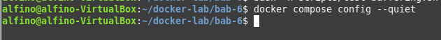

- **Analisis:** Perintah ini menguji keabsahan format YAML pada compose.yaml sekaligus memastikan seluruh variabel dari .env berhasil diinterpolasi dengan benar. Opsi --quiet membuat perintah tidak mengeluarkan teks apa pun dan mengembalikan kode keluar 0 jika konfigurasi valid, atau menampilkan pesan kesalahan jika ada kesalahan indentasi/sintaks.

> **19. Memvalidasi konfigurasi Fluent Bit dengan mode dry-run**
>
> 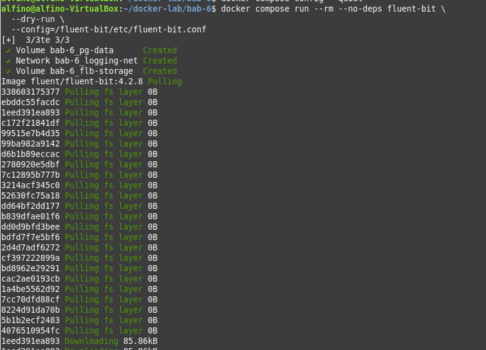
>
> 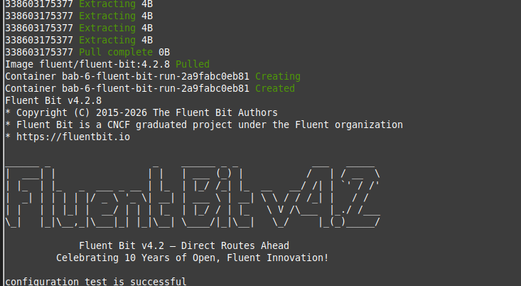

- **Analisis:** Perintah ini menjalankan kontainer sementara Fluent Bit (--rm) tanpa menyalakan dependensi database (--no-deps) untuk menguji apakah sintaks fluent-bit.conf dan nama properti plugin dikenali.

> **20. Menjalankan service inti (Alternatif validasi jika --dry-run tidak dikenali)**
>
> 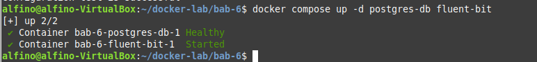

- **Analisis:** Perintah ini menjalankan kontainer postgres-db dan fluent-bit di latar belakang (*detached mode* -d), di mana Fluent Bit baru akan menyala setelah postgres-db mencapai status healthy.

> **21. Memeriksa log startup Fluent Bit**
>
> 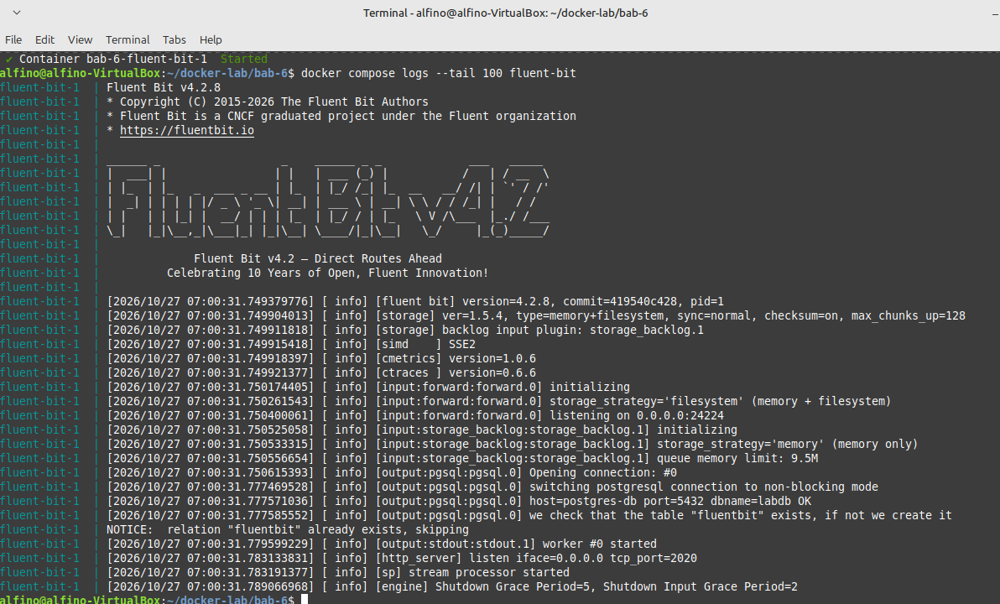

- **Analisis:** Perintah ini menampilkan 100 baris log terakhir dari kontainer fluent-bit untuk memastikan proses collector berjalan normal tanpa kesalahan unknown configuration property atau kegagalan koneksi ke PostgreSQL.

> **Kotak Perintah C Menjalankan Pipeline dan Menghasilkan Log**
>
> **22. Menjalankan skrip generate log**
>
> 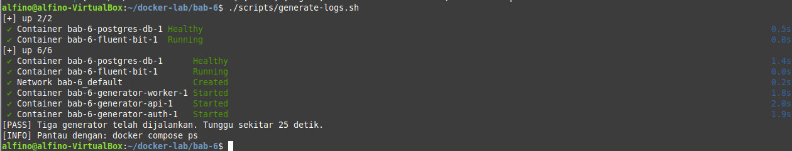

- **Analisis:** Perintah ini mengeksekusi skrip untuk memastikan PostgreSQL dan Fluent Bit aktif serta sehat, lalu menjalankan ulang ketiga kontainer generator (auth, api, worker) untuk mengirimkan log ke port 24224.

> **23. Menunggu proses pengiriman log selesai**
>
> 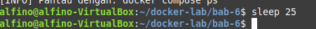

- **Analisis:** Perintah ini menunda eksekusi terminal selama 25 detik karena masing-masing kontainer generator membutuhkan waktu 20 detik (20 iterasi dengan jeda sleep 1 detik) untuk menyelesaikan pengiriman seluruh event log.

> **24. Memeriksa status seluruh kontainer**
>
> 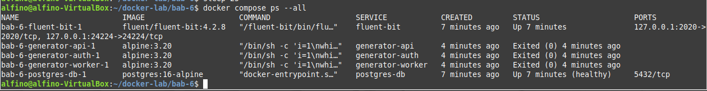

- **Analisis:** Perintah ini menampilkan status seluruh kontainer termasuk yang sudah berhenti (--all). Kondisi yang diharapkan adalah postgres-db berstatus Up (healthy), fluent-bit berstatus Up, dan ketiga generator berstatus Exited (0) karena tugas pengirimannya telah tuntas.

> **Kotak Perintah D Memeriksa Monitoring Fluent Bit**
>
> **25. Memeriksa endpoint kesehatan Fluent Bit**
>
> 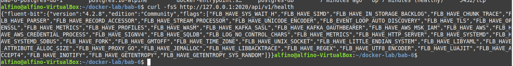

- **Analisis:** Perintah ini memanggil endpoint HTTP kesehatan internal Fluent Bit di alamat lokal 127.0.0.1:2020 menggunakan opsi -fsS (gagal bila HTTP error, senyap tanpa progress bar, namun tetap menampilkan pesan error jika gagal).

> **26. Memeriksa metrik internal pipeline Fluent Bit**
>
> 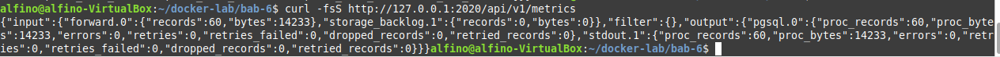

- **Analisis:** Perintah ini mengambil data telemetri internal Fluent Bit dalam format JSON yang merinci jumlah paket log yang masuk pada plugin input serta jumlah record yang berhasil dikirim atau di-*retry* pada plugin output (pgsql dan stdout).

> **Kotak Perintah E Memverifikasi Record PostgreSQL**
>
> **27. Mengaktifkan mode ekspor otomatis**
>
> 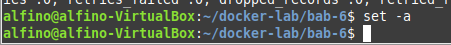

- **Analisis:** Perintah bawaan Bash ini mengaktifkan opsi *allexport*, sehingga setiap variabel yang didefinisikan atau dimuat setelah perintah ini secara otomatis diekspor ke *environment* untuk sub-proses berikutnya.

> **28. Memuat variabel dari file .env**
>
> 

- **Analisis:** Perintah ini membaca dan memuat daftar variabel seperti POSTGRES_USER dan POSTGRES_DB dari berkas .env ke dalam sesi terminal saat ini agar dapat langsung dipakai pada perintah psql.

> **29. Menonaktifkan kembali mode ekspor otomatis**
>
> 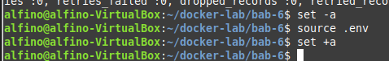

- **Analisis:** Perintah ini mematikan kembali opsi *allexport* setelah .env selesai dimuat agar variabel lokal lain yang dibuat di terminal setelahnya tidak ikut bocor ke *environment* global.

> **30. Menjalankan berkas query analisis pada PostgreSQL**
>
> 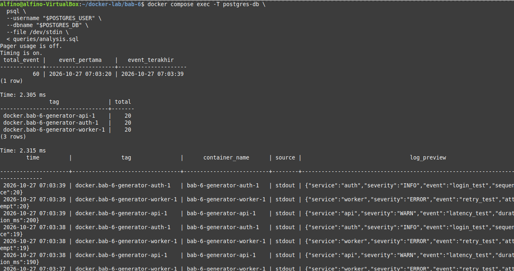

- **Analisis:** Perintah ini mengeksekusi klien psql di dalam kontainer postgres-db tanpa alokasi pseudo-TTY (-T) dengan mengalirkan isi berkas queries/analysis.sql dari host melalui (/dev/stdin). Hasilnya menampilkan total event, distribusi log per tag generator, pratinjau metadata, hasil filter ERROR, dan laju log per menit.

> **31. Memeriksa isi view logs.recent_logs**
>
> 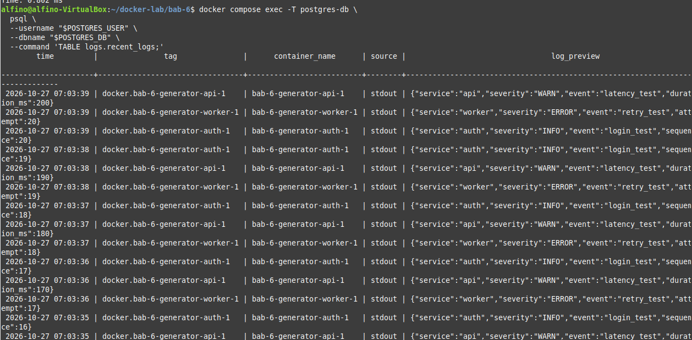

- **Analisis:** Perintah ini menjalankan kueri singkat TABLE logs.recent_logs; (setara dengan SELECT \* FROM logs.recent_logs;) di dalam kontainer PostgreSQL. Outputnya memverifikasi bahwa view berhasil mengekstrak nama kontainer, sumber aliran (stdout/stderr), dan 200 karakter pertama pesan log dari kolom JSONB.

> **Kotak Perintah F Menguji Buffering, Pemulihan, dan Verifikasi Tipe Data**
>
> **32. Menjalankan skenario uji penghentian database sementara**
>
> 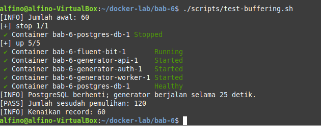

- **Analisis:** Perintah ini menjalankan pengujian simulasi gangguan di mana PostgreSQL dimatikan selama 25 detik saat ketiga generator mengirim log, lalu dinyalakan kembali. Status \[PASS\] membuktikan bahwa Fluent Bit berhasil menahan antrean log pada volume buffer disk flb-storage dan mengirimkannya ke database begitu koneksi pulih.

> **33. Mengamati catatan retry pada log Fluent Bit**
>
> 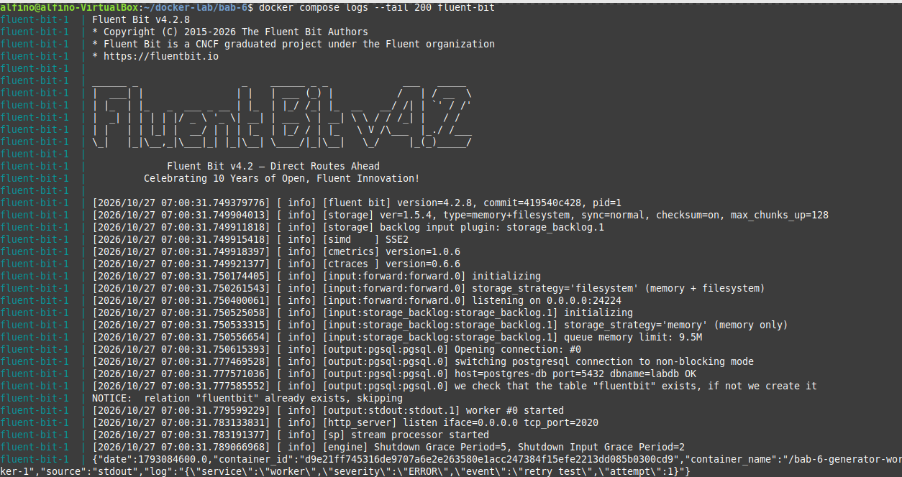

- **Analisis:** Perintah ini menampilkan 200 baris log terakhir dari fluent-bit untuk menyediakan bukti (*evidence*) bahwa saat PostgreSQL mati, Fluent Bit mencatat kegagalan koneksi output dan melakukan mekanisme *retry* penulisan tanpa membuat proses collector mati.

> **34. Memeriksa daftar volume penyimpanan Docker**
>
> 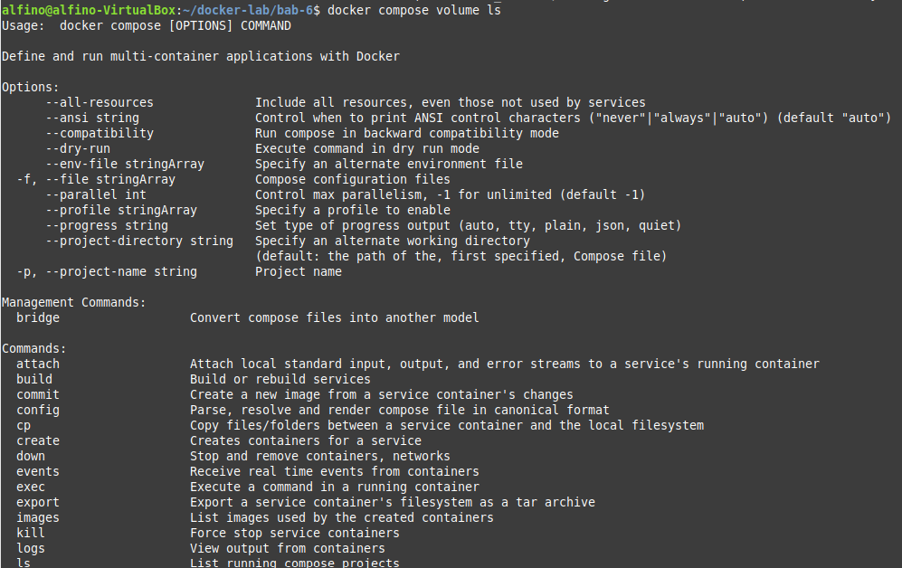

- **Analisis:** Perintah ini menampilkan volume yang terikat pada proyek Compose (pg-data untuk penyimpanan database dan flb-storage untuk *filesystem buffer* Fluent Bit) guna memastikan media penyimpanan persisten aktif dan tersedia.

> **35. Memverifikasi tipe data kolom data sebagai JSONB**
>
> 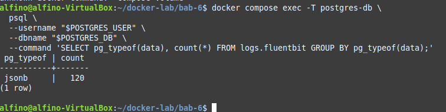

- **Analisis:** Perintah ini menggunakan fungsi internal PostgreSQL pg_typeof(data) untuk membuktikan secara pasti bahwa seluruh baris log pada tabel logs.fluentbit tersimpan dengan tipe data biner terstruktur jsonb

> **Kotak Perintah G Cleanup (Pembersihan Lingkungan)**

**36. Menghentikan kontainer tanpa menghapus data volume**

> 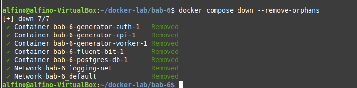

- **Analisis:** Perintah ini menghentikan dan menghapus seluruh kontainer, jaringan logging-net, serta kontainer yatim (*orphans*) yang tidak lagi terdaftar di compose.yaml, namun tetap mempertahankan data log di dalam volume pg-data dan flb-storage.

> **37. Menghapus seluruh kontainer beserta volume penyimpanan**
>
> Bash
>
> docker compose down --volumes --remove-orphans
>
> **(Tidak dilakukan pengahapusan container dan volumenya)**

- **Analisis:** Penambahan opsi --volumes bersifat destruktif karena menghapus seluruh kontainer sekaligus memusnahkan volume pg-data dan flb-storage beserta seluruh isi tabel log di dalamnya. Perintah ini hanya boleh dijalankan setelah seluruh tangkapan layar dan bukti laporan praktikum selesai disimpan.

3.  **Jawaban Evaluasi dan Latihan Mandiri**

<!-- -->

1.  **Apa risiko kehilangan log ketika Fluent Bit tidak tersedia?**

    Ketika Fluent Bit sebagai collector tidak tersedia sementara opsi fluentd-async: "true" diaktifkan, Docker Engine hanya menampung log di dalam buffer memori internal yang kapasitasnya terbatas, sehingga jika gangguan berlangsung lama hingga buffer penuh, record log baru akan langsung terbuang dan menyebabkan hilangnya jejak atau bukti insiden.Namun apabila logging driver berjalan dalam mode blocking atau buffer tidak terkendali saat tujuan log mati, proses penulisan log pada aplikasi akan tertahan atau kontainer gagal melakukan startup, yang pada akhirnya mengganggu ketersediaan layanan utama.

2.  **Apa risiko kehilangan log ketika Fluent Bit tidak tersedia?**

    Structured logging (seperti format JSON yang disimpan ke kolom JSONB) jauh lebih mudah dianalisis karena setiap peristiwa dicatat menggunakan field yang konsisten dan terstandarseperti timestamp, severity, service, event type, serta correlation IDsehingga mesin pencari atau basis data dapat langsung memfilter, mengelompokkan, dan menelusuri transaksi lintas komponen tanpa harus menebak pola kalimat teks bebas.

3.  **Kapan PostgreSQL tidak lagi cocok sebagai log storage utama?**

    Ketika sistem sudah memasuki skala produksi dengan volume event yang sangat masif, laju traffik yang tinggi, kebutuhan retensi jangka panjang, serta beban full-text search yang intensif. Karena kondisi itu baris dan pembaruan indeks pada basis data relasional akan memakan biaya CPU, memori, dan kapasitas penyimpanan yang besar serta memperlambat performa kueri, sehingga organisasi perlu beralih ke platform yang dirancang khusus untuk skala besar seperti Grafana Loki, OpenSearch, atau ClickHouse.

4.  **Apa perbedaan log untuk observability dan log untuk forensik?\**
    Log untuk observability berfokus pada pemantauan operasional dan debugging teknis seperti membaca error stack, melacak latency, dan mencari tahu mengapa performa sebuah layanan menurunagar tim pengembang dapat segera memulihkan gangguan sistem. Sementara itu, log untuk forensik berfokus pada investigasi keamanan dan kepatuhan untuk membuktikan secara sahih siapa melakukan apa, pada resource mana, kapan, dari konteks apa, dan dengan keputusan policy apa, sehingga menuntut perlindungan integritas yang ketat melalui pembatasan akses read-only bagi analis, larangan modifikasi data, pencatatan checksum saat ekspor, serta penyimpanan pada media immutable.

5.  **Buat query SQL untuk menampilkan jumlah log per menit dalam 10 menit terakhir.**

    Untuk menghitung jumlah log yang masuk di setiap menit selama rentang 10 menit terakhir pada tabel logs.fluentbit, Anda dapat memadukan fungsi pemotongan waktu date_trunc('minute', time) dengan filter interval waktu CURRENT_TIMESTAMP - INTERVAL '10 minutes' melalui kueri SQL berikut:

<table style="width:92%;">
<colgroup>
<col style="width: 92%" />
</colgroup>
<thead>
<tr>
<th>
SELECT

date_trunc('minute', time) AS minute_bucket,

COUNT(*) AS total_log

FROM logs.fluentbit

WHERE time &gt;= CURRENT_TIMESTAMP - INTERVAL '10 minutes'

GROUP BY minute_bucket

ORDER BY minute_bucket DESC;
</th>
</tr>
</thead>
<tbody>
</tbody>
</table>

4.  **Skenario Logging Aplikasi PMB**

    **Gambaran Umum Skenario**

    Tugas ini menguji kemampuan **Observability & DevSecOps**:

<!-- -->

1.  Tentang masalah Container berstatus Up (hidup), tetapi transaksi pendaftaran berhenti di status PROCESSING / FAILED.

2.  Tujuannya untuk membuktikan akar masalah secara objektif menggunakan **Centralized Logging** (Fluent Bit + PostgreSQL JSONB) dan korelasi request_id, bukan sekadar memeriksa status container.

3.  **Alur** 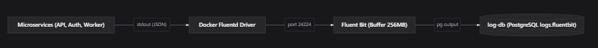

> **Tahap 0: Persiapan Lingkungan di Linux**
>
> Buka terminal di Linux Mint pada direktori proyek:

1.  Jalankan setup untuk membuat file .env dengan kredensial yang aman

    ./scripts/setup.sh

    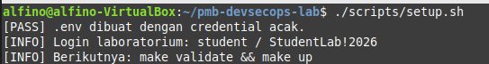

2.  Validasi kelengkapan tools dan konfigurasi

    ./scripts/validate.sh

    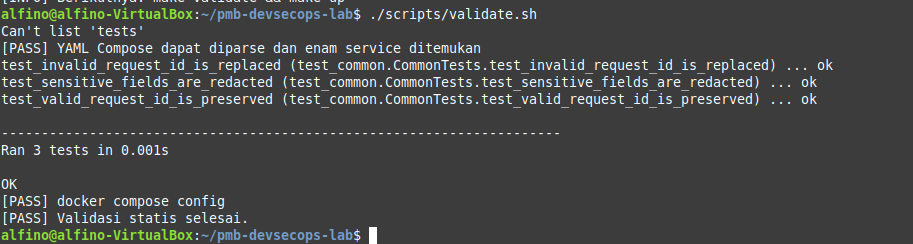

3.  Jalankan container secara background

    docker compose up -d –build

    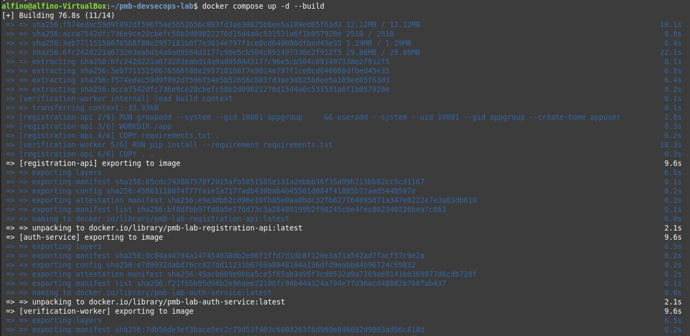

4.  Pastikan semua service sehat (healthy)

    docker compose ps

    curl -fsS http://127.0.0.1:8080/healthz

    curl -fsS <http://127.0.0.1:2020/api/v1/health>

    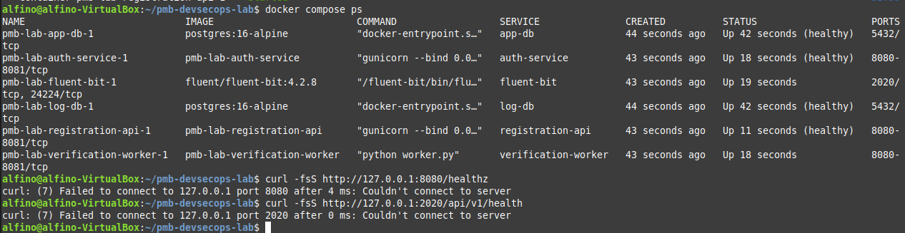

    Terdapat failed to connect dikarenakan PORTS pada output docker compose ps seperti pmb-lab-registration-api-1 tertulis: 8080-8081/tcp dan pmb-lab-fluent-bit-1 tertulis: 2020/tcp, 24224/tcp, menandakan port hanya terbuka secara internal di dalam kontainer, bukan terhubung ke host (seharusnya berformat 127.0.0.1:8080-\>8080/tcp).

> **Solusi & Langkah Perbaikan**

- Buka file compose.yaml di Linux Mint (misal dengan nano compose.yaml) dan hapus baris bagian paling bawah file compose.yaml , **internal: true**, sehingga menjadi:

  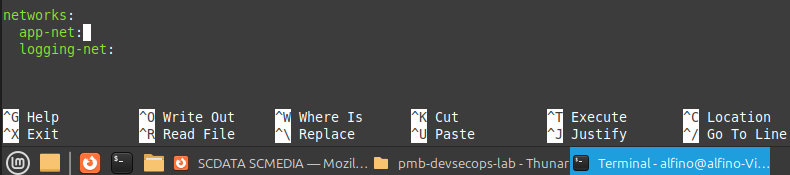

- **Restart container**

  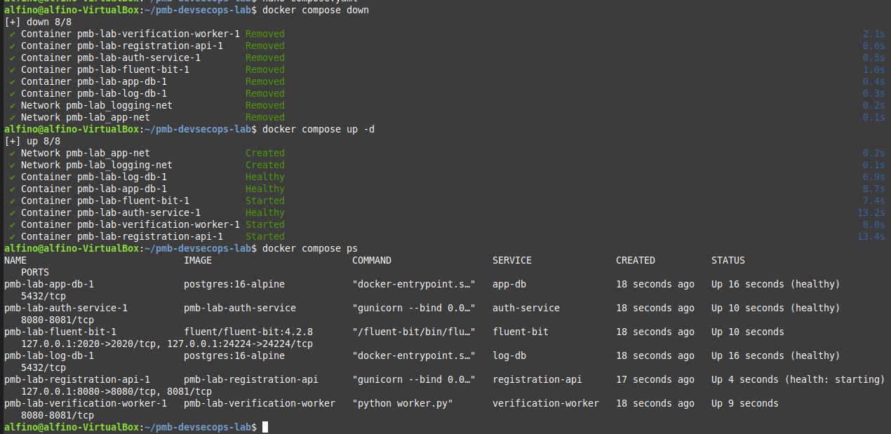

  curl -fsS http://127.0.0.1:8080/healthz

  curl -fsS <http://127.0.0.1:2020/api/v1/health>

  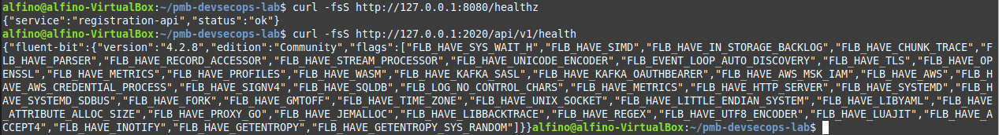

> Kredensial login mahasiswa:

- **URL**: http://127.0.0.1:8080

- **Username**: student

- **Password**: StudentLab!2026

> **Tahap A — Baseline (Alur Normal)**
>
> Tujuan: Membentuk garis dasar (*baseline*) urutan event saat sistem berjalan tanpa gangguan.
>
> **Cara Eksekusi:**
>
> Opsi 1 (Otomatis):
>
> bash
>
> ./scripts/demo-normal.sh
>
> 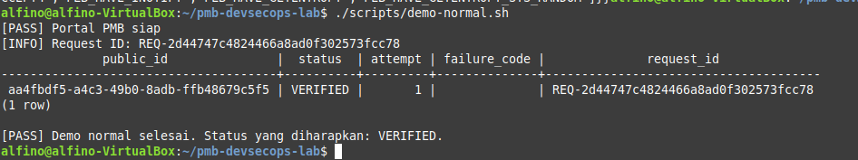
>
> Opsi 2 (Manual via browser/terminal):
>
> bash
>
> 1\. Pastikan mode normal aktif
>
> ./scripts/set-incident.sh none
>
> 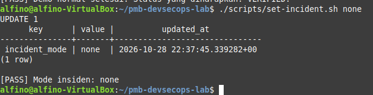
>
> 2\. Buka http://127.0.0.1:8080 di browser, login, dan kirim formulir pendaftaran.
>
> Catat Request ID yang muncul di header atau layar.
>
> 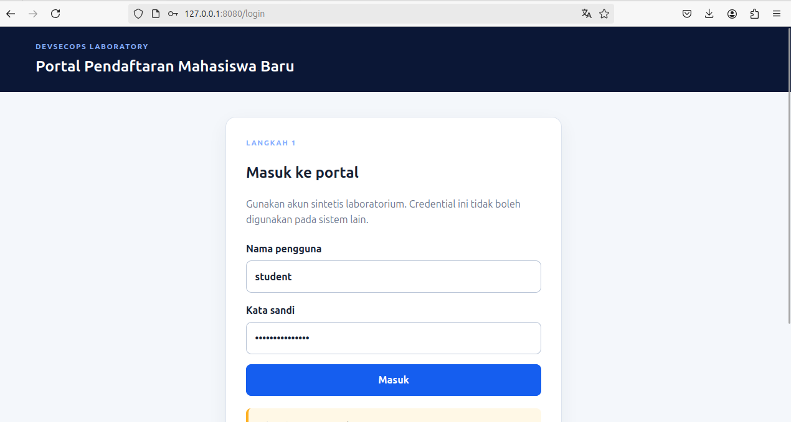
>
> 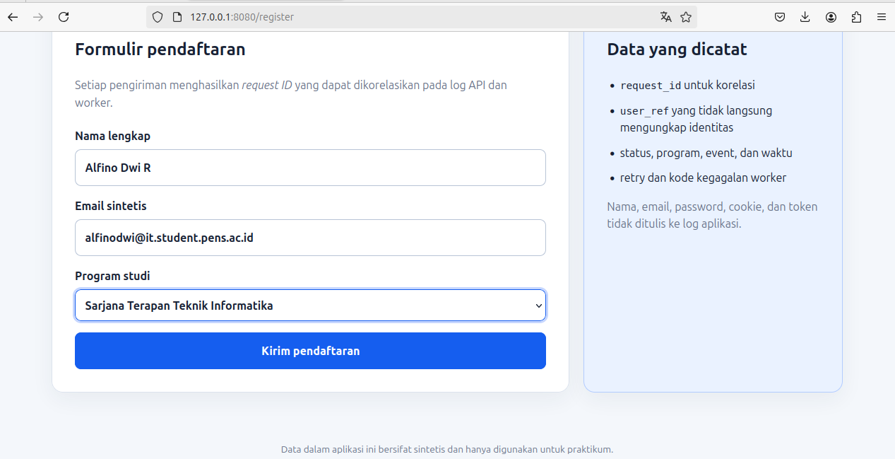
>
> 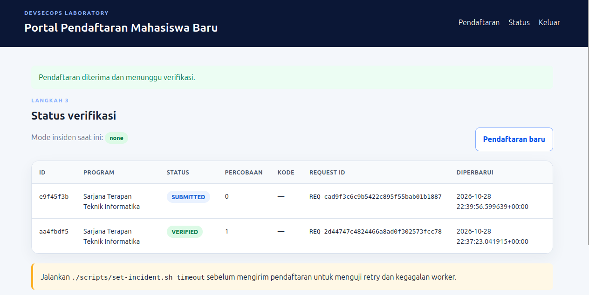
>
> Req id : REQ-2d44747c4824466a8ad0f302573fcc78
>
> **Observasi & Pengambilan Bukti:**

1.  **Periksa Status Transaksi di app-db**:

> bash
>
> set -a; source .env; set +a
>
> docker compose exec -T app-db psql -U "\$APP_DB_ADMIN_USER" -d "\$APP_DB_NAME" \\
>
> -c "SELECT public_id, status, attempt, failure_code, request_id FROM registrations ORDER BY submitted_at DESC LIMIT 1;"
>
> *Ekspektasi*: Status akhir adalah VERIFIED, attempt: 1, failure_code: NULL.
>
> 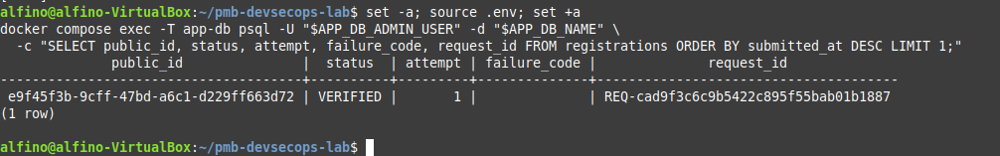

2.  **Periksa Urutan Kronologi Event di log-db**: Ganti variabel investigated_request_id pada file queries/incident-analysis.sql dengan Request ID baseline yang diperoleh, lalu jalankan:

    bash

    docker compose exec -T log-db psql -U "\$LOG_DB_ADMIN_USER" -d "\$LOG_DB_NAME" \\

    --file=/dev/stdin \< queries/incident-analysis.sql

    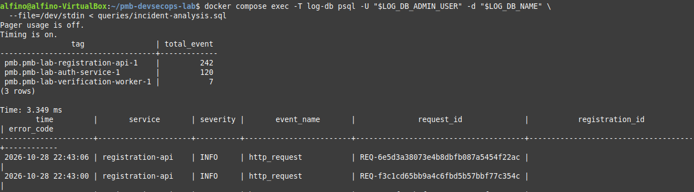

    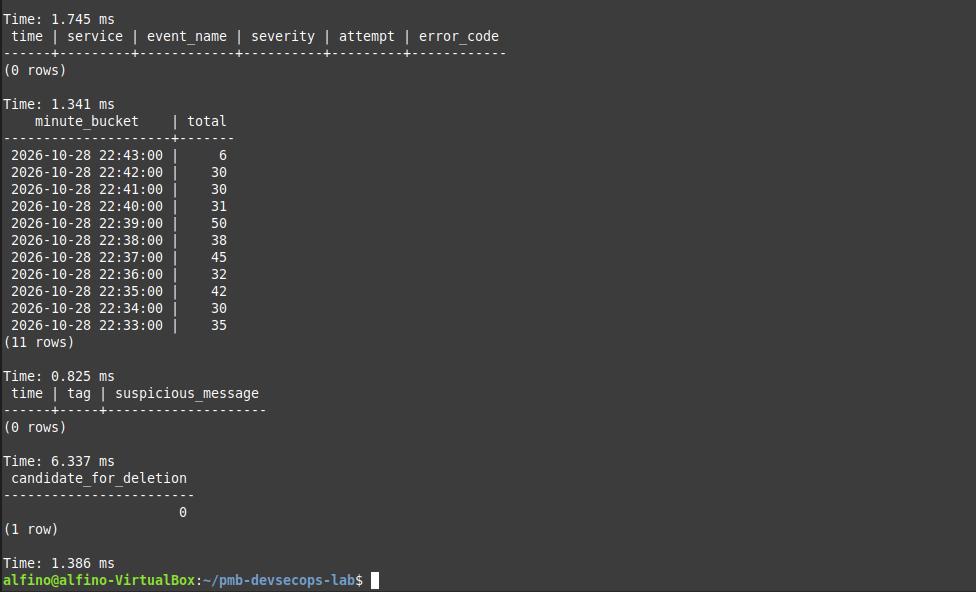

> **Tahap B — Failure Injection (Simulasi)**
>
> Tujuan: Menemukan service penyebab kegagalan melalui centralized log tanpa membaca kode aplikasi terlebih dahulu.
>
> **Eksekusi:**
>
> bash
>
> 1\. Aktifkan mode kegagalan
>
> ./scripts/set-incident.sh timeout
>
> 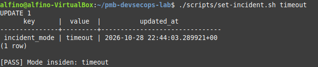
>
> 2\. Kirim transaksi pendaftaran baru (via browser atau script demo)
>
> ./scripts/demo-incident.sh
>
> 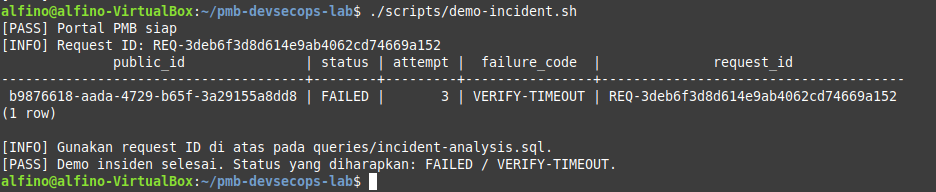
>
> **Observasi:**

1.  **Periksa status transaksi**:

    bash

    docker compose exec -T app-db psql -U "\$APP_DB_ADMIN_USER" -d "\$APP_DB_NAME" \\

    -c "SELECT public_id, status, attempt, failure_code, request_id FROM registrations ORDER BY submitted_at DESC LIMIT 1;"

    *Ekspektasi*: Status transaksi berubah menjadi FAILED, attempt: 3, failure_code: VERIFY-TIMEOUT.

    

2.  **Analisis Log Terpusat**: Ganti investigated_request_id di queries/incident-analysis.sql dengan Request ID insiden tadi, lalu jalankan kembali query:

    bash

    docker compose exec -T log-db psql -U "\$LOG_DB_ADMIN_USER" -d "\$LOG_DB_NAME" \\

    --file=/dev/stdin \< queries/incident-analysis.sql

    

    

3.  **Temuan yang dicatat untuk laporan**:

    Service pertama yang menghasilkan peringatan: verification-worker.

    Event sequence:

    1.  verification_started (INFO)

    2.  verification_retry (WARN, attempt 1, 2, 3 — ketergantungan: document-verifier)

    3.  dependency_timeout (ERROR, error_code: VERIFY-TIMEOUT).

> **Tahap C — Recovery & Evaluasi Arsitektur**
>
> Tujuan: Menguji pemulihan sistem dan menjelaskan mekanisme retry.
>
> **Cara Eksekusi:**
>
> bash
>
> 1\. Kembalikan mode insiden ke normal
>
> ./scripts/set-incident.sh none
>
> 
>
> 2\. Kirim pendaftaran baru
>
> ./scripts/demo-normal.sh
>
> 
>
> **Analisis Tahap C:**

- **Mengapa pendaftaran lama yang berstatus FAILED tidak otomatis sembuh?** Karena worker hanya mengambil (*claim*) transaksi dengan kriteria status = 'SUBMITTED'. Transaksi yang sudah FAILED tidak diambil ulang untuk mencegah *infinite loop* atau beban berlebih pada downstream service.

- **Usulan Solusi Produksi**:

  - Terapkan **Dead-Letter Queue (DLQ)** untuk menampung transaksi yang gagal setelah batas retry habis.

  - Sediakan mekanisme manual re-trigger oleh operator atau worker rekonsiliasi terjadwal dengan *exponential backoff*.

> **Tahap D — Resilience Logging (Uji Buffering Fluent Bit)**
>
> Tujuan: Membuktikan bahwa event log tidak hilang saat database log mengalami *downtime*.
>
> **Cara Eksekusi:**
>
> bash
>
> 1\. Catat jumlah log sebelum pengujian
>
> docker compose exec -T log-db psql -U "\$LOG_DB_ADMIN_USER" -d "\$LOG_DB_NAME" \\
>
> -c "SELECT count(\*) FROM logs.fluentbit;"
>
> 
>
> 2\. Matikan database log sementara
>
> docker compose stop log-db
>
> 
>
> 3\. Lakukan Create baru di web portal atau curl <http://127.0.0.1:8080>
>
> 
>
> 
>
> 4\. Amati bahwa Fluent Bit menyimpan log di storage buffer dan melakukan retry:
>
> docker compose logs --tail 30 fluent-bit
>
> 
>
> 5\. Nyalakan kembali database log
>
> docker compose start log-db
>
> 
>
> 6\. Tunggu beberapa detik, lalu periksa kembali jumlah record di log-db:
>
> docker compose exec -T log-db psql -U "\$LOG_DB_ADMIN_USER" -d "\$LOG_DB_NAME" \\
>
> -c "SELECT count(\*) FROM logs.fluentbit;"
>
> 
>
> *Hasil*: Jumlah record bertambah membuktikan backlog berhasil dikirim dari buffer disk Fluent Bit.
>
> **Pengumpulan Evidence & Pengujian Unit**
>
> bash
>
> Menghasilkan seluruh laporan di direktori reports/
>
> ./scripts/collect-evidence.sh
>
> 
>
> Verifikasi pipeline secara keseluruhan
>
> ./scripts/verify.sh
>
> 
>
> Menjalankan unit test sanitasi secret & request ID
>
> python -m unittest discover -s app/tests -v
>
> 
>
> Semua bukti screenshot, teks dump transaksi, metrik Fluent Bit, dan hash sha256 konfigurasi tersimpan rapi di dalam folder reports/.
>
> **Jawaban untuk Pertanyaan Analiti (docs/SCENARIO.md)**

1.  **Mengapa status container Up tidak membuktikan fungsi bisnis sehat?**\
    Status Up hanya menandakan proses utama sistem operasi/runtime kontainer masih berjalan, tetapi tidak memvalidasi apakah koneksi dependensi eksternal, timeout thread, atau logic bisnis internal mengalami kebuntuan (*deadlock/dependency failure*).

2.  **Apa perbedaan event time, waktu penerimaan collector, dan waktu penyimpanan database?**

    - *Event time*: Waktu saat peristiwa terjadi di kode aplikasi (dicatat pada payload JSON timestamp).

    - *Waktu penerimaan collector*: Waktu paket log sampai di daemon Fluent Bit.

    - *Waktu penyimpanan database*: Waktu record di-insert ke tabel PostgreSQL (CURRENT_TIMESTAMP). Selisih ketiganya mengukur latensi pipeline log (*ingestion delay*).

3.  **Mengapa nama dan email tidak dimasukkan ke structured log?**\
    Untuk mematuhi prinsip privasi. Log sering diakses oleh banyak pihak operasional dan disimpan lebih lama. Identifikasi cukup menggunakan identifier anonim seperti user_ref atau request_id.

4.  **Apa risiko penggunaan request_id dari client tanpa validasi?**\
    Client jahat dapat melakukan *log injection*, pemalsuan jejak audit (*spoofing audit trail*), atau mengirim string sangat panjang untuk menyebabkan *denial-of-service* pada storage. Oleh karena itu, app/common.py memvalidasi pola regex dan membuat ID baru jika tidak valid.

5.  **Apa yang terjadi bila buffer Fluent Bit mencapai batas 256 MB?**\
    Jika disk buffer penuh dan backend log masih mati, Fluent Bit akan menghentikan penerimaan log baru (*backpressure*), memblokir stdout aplikasi (jika mode sync), atau mulai membuang log (*drop oldest/tail*) sesuai konfigurasi storage.max_chunks_up.

6.  **Bagaimana mendeteksi duplikasi record setelah retry?**\
    Dengan membandingkan kombinasi unik (request_id, event, timestamp) atau menambahkan event_id unik berbasis UUID pada setiap log entry, lalu melakukan query GROUP BY event_id HAVING count(\*) \> 1.

7.  **Kapan PostgreSQL tidak lagi sesuai sebagai backend log utama?**\
    Ketika volume log mencapai puluhan ribu event per detik (tingkat throughput ingest tinggi), ukuran indeks JSONB bengkaksehingga write I/O jenuh, atau query teks analitis membutuhkan pencarian terdistribusi (di mana sistem seperti ClickHouse, OpenSearch, atau Grafana Loki).

8.  **Kontrol apa yang harus ditambahkan sebelum arsitektur serupa dipakai pada produksi?**\
    Enkripsi in-transit (TLS/mTLS antarservice dan ke logging backend), autentikasi tersentralisasi dengan secret manager (bukan via environment file plain), rate-limiting ingest, retensi log otomatis dengan partisi tabel, dan alerting berbasis metrik anomaly/error count.
